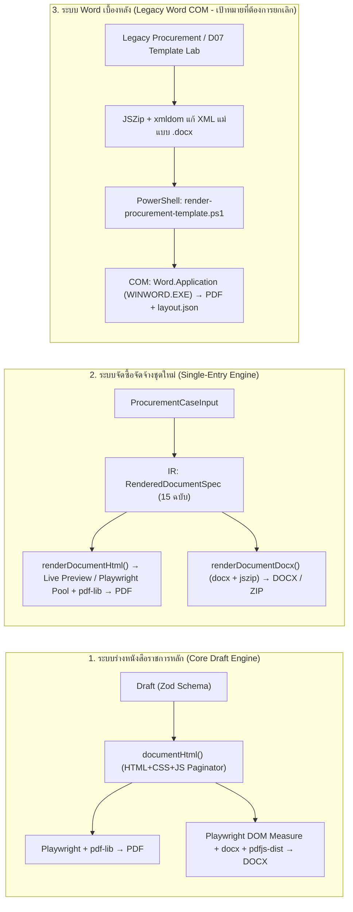
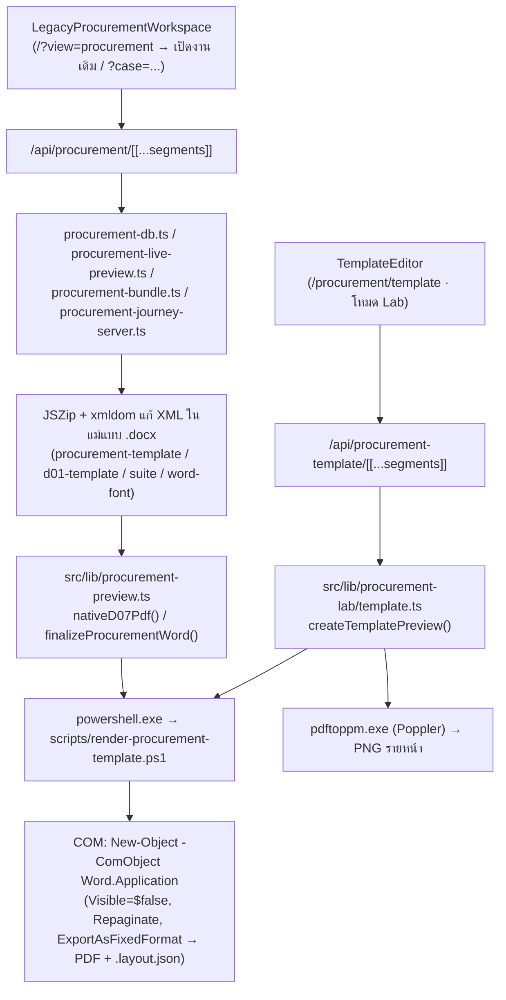

# สรุปโครงสร้างสถาปัตยกรรมระบบเอกสารเดิม (`ARCHITECTURE_DRAFT`)

> อัปเดต 23 พฤศจิกายน 2569: เนื้อหาด้านล่างเป็นภาพสถาปัตยกรรมก่อนย้ายระบบ ปัจจุบันปิดเส้นทาง Word COM และระบบร่างเก่าแล้ว เช็กลิสต์เปิด Core Editor โดยตรง และข้อมูลเดิมอ่านผ่านคลังเอกสาร ดูสถานะล่าสุดใน `docs/procurement-core-mapper.md`

> เอกสารอ้างอิงจากการสแกนโค้ดจริงในโปรเจกต์ `sarabun-workspace` (v1.7.1 · Next.js 16.4.6 · React 19 · Node.js `node:sqlite`)
> จัดทำเพื่อใช้วางแผนปรับปรุงระบบร่างเอกสาร ระบบจัดการรูปภาพ และการยกเลิกระบบ Microsoft Word เบื้องหลัง (ยังไม่มีการแก้ไขโค้ดใดๆ)

---

## ภาพรวมระบบเอกสารที่มีอยู่ในโปรเจกต์ปัจจุบัน

ในโปรเจกต์นี้มีเอนจินสร้างเอกสารอยู่ **3 สายงานหลัก** ทำงานควบคู่กัน (ไม่รวมเอนจินรายงานย่อยของพัสดุ/โครงการ/ทะเบียนรับ-ส่ง):



---

## 1. ระบบร่างเอกสาร (Draft Document Engine)

### 1.1 ระบบร่างหนังสือราชการหลัก (Core Sarabun Draft Engine)

ใช้สร้างหนังสือราชการมาตรฐาน 13 ประเภท ตั้งแต่แสดงตัวอย่าง A4 แบบสดในเบราว์เซอร์ ไปจนถึงส่งออก PDF และ DOCX โดย**ไม่เรียกใช้ Microsoft Word บนเครื่อง**

#### ตำแหน่งโฟลเดอร์และไฟล์หลัก

| หน้าที่ | ไฟล์ | รายละเอียด |
| :--- | :--- | :--- |
| Schema & Business Rules | `src/lib/document.ts` | กำหนด `documentSchema` (Zod), Type `Draft` / `SavedDraft`, `bodySections()`, `documentChecks()`, `numerals()` |
| ทะเบียนแบบหนังสือและระยะกระดาษ | `src/lib/templates.ts` | นิยามแบบหนังสือ 13 แบบ และค่ามาตรฐานกระดาษ A4 (`210×297 มม.`, ขอบซ้าย 30 / ขวา 20 / บน 25 / ล่าง 20 มม., 16 pt, ย่อหน้า 25 มม.) |
| HTML Renderer + A4 Paginator | `src/lib/render-document.ts` | `documentHtml()` สร้าง HTML เต็มฉบับพร้อม CSS และ inline `<script>` ตัดแบ่งหน้า A4 อัตโนมัติ, ใส่เลขหน้า, ใบต่อบันทึกข้อความ, คำขึ้นต้นหน้าถัดไป (continuation cue), จุดไข่ปลา (`.document-dot-guide`) และสำเนาคู่ฉบับ |
| Inline Typography & Thai Layout | `src/lib/body-typography.ts`, `src/lib/thai-layout.ts`, `src/lib/preview-overlays.ts` | แปลงมาร์กอัป (`**bold**`, `[space=...]`, `## หัวข้อ`, Markdown Table), ป้องกันคำฉีกข้ามบรรทัด (`.thai-keep` จากพจนานุกรมคำไทย), และสคริปต์ลาก/ย่อขยาย overlay ใน iframe ตัวอย่าง |
| โหลด Asset คงที่ (ฟอนต์/ตราครุฑ) | `src/lib/assets.ts` | `documentAssets()` อ่านไฟล์จาก `public/fonts/THSarabunIT9*.ttf` และ `public/assets/{garuda,approval-routing-stamp,copy-counterpart}.png` แปลงเป็น Base64 Data URI และ cache ในหน่วยความจำ |
| สร้าง PDF | `src/lib/pdf.ts`, `src/app/api/documents/[id]/pdf/route.ts` | `renderPdf(draft)` เปิด Chromium แบบ headless, รัน pagination ในหน้า, `page.pdf()` แล้วต่อไฟล์แนบท้ายด้วย `appendAttachments()` |
| สร้าง DOCX (Pure JS + Playwright) | `src/lib/word.ts`, `src/lib/word-layout.ts`, `src/app/api/documents/[id]/word/route.ts` | `renderWord(draft)` วัดพิกัดจริงจาก DOM ใน Chromium (`extractWordPages`) แล้วประกอบ OOXML ผ่านไลบรารี `docx` |
| รวมไฟล์แนบ PDF | `src/lib/attachments.ts` | `appendAttachments()` รวมไฟล์ PDF/รูปแนบท้ายหนังสือปะหน้า (รองรับชุดต้นฉบับ + สำเนาคู่ฉบับ) |
| ฐานข้อมูล & การจัดแฟ้มลงดิสก์ | `src/lib/db.ts`, `src/lib/local-dossiers.ts`, `scripts/workspace-files.mjs` | เก็บร่างเป็น JSON ในตาราง `documents` (`data/sarabun.sqlite`) และ mirror สำเนาออกโฟลเดอร์เรื่อง |
| หน้าจอแก้ไขและตัวอย่างสด | `src/components/workspace.tsx`, `src/components/document-form.tsx`, `src/components/body-editor.tsx`, `src/components/word-body-editor.tsx`, `src/components/minutes-editor.tsx` | ฟอร์มกรอกข้อมูลคู่กับ `<iframe>` แสดง `documentHtml()` แบบเรียลไทม์ (debounce 300ms) |

#### ไลบรารีที่ใช้ในการสร้างเอกสาร

| Output | ไลบรารีหลัก | กลไกการทำงาน |
| :--- | :--- | :--- |
| **Live A4 Preview** | HTML/CSS/JS ใน `<iframe>` (`srcDoc`) | รัน `documentHtml()` ฝั่ง client โดยตรง (ไม่ต้องเรียกเซิร์ฟเวอร์) แล้วสื่อสารจำนวนหน้า/overflow/ตำแหน่ง overlay ผ่าน `postMessage` (`sarabun-preview`, `sarabun-overlay-*`) |
| **PDF** | `playwright` (`chromium`) + `pdf-lib` | เปิด Chrome/Edge บนเครื่อง (`CHROMIUM_EXECUTABLE_PATH` หรือ path มาตรฐาน), บล็อก network ทั้งหมด (`page.route("**/*", abort)`), รอ `window.__paginationDone`, พิมพ์ด้วย `page.pdf({ format: "A4", preferCSSPageSize: true, printBackground: true })` แล้วรวมไฟล์แนบด้วย `pdf-lib` |
| **DOCX** | `playwright` + `docx` (v9.10.0) + `pdfjs-dist` + `jszip` | เรนเดอร์ HTML ใน Chromium (`wordParagraphs: true`) → อ่านพิกัด/สไตล์จริงทุกองค์ประกอบผ่าน `extractWordPages()` → สร้าง `.docx` ด้วย `docx` (`Document`, `Packer`, `Paragraph`, `Table`, `ImageRun`, `ShapeRun`) พร้อมฝังฟอนต์ `TH SarabunIT๙` → แปลง PDF แนบเป็นภาพ JPEG ด้วย `pdfjs-dist` → ถ้าเป็น `internal`/`memorandum` จะเรียก `continuationFooter()` (`jszip` ใน `src/lib/procurement-pagination.ts`) เติมใบต่อท้ายกระดาษ |

#### โครงสร้างข้อมูลและ Template ที่รับเข้าไป (`Draft` / `documentSchema`)

- **รูปแบบ Template:** ไม่ได้ใช้ไฟล์เทมเพลตภายนอก (`.docx`/`.hbs`) แต่ใช้โค้ด TypeScript ใน `src/lib/render-document.ts` (`switch (d.type)`) ประกอบ HTML block ตามประเภทหนังสือทั้ง **13 แบบ** ใน `src/lib/templates.ts`:
  - `external` (หนังสือภายนอก), `internal` (หนังสือภายใน/บันทึกข้อความ), `stamped` (หนังสือประทับตรา)
  - `order` (คำสั่ง), `regulation` (ระเบียบ), `rule` (ข้อบังคับ)
  - `announcement` (ประกาศ), `statement` (แถลงการณ์), `news` (ข่าว)
  - `certificate` (หนังสือรับรอง), `minutes` (รายงานการประชุม), `memorandum` (บันทึก), `other` (หนังสืออื่น)
- **โครงสร้างข้อมูลอินพุตหลัก (`Draft` ใน `src/lib/document.ts`):**

```ts
// สรุปฟิลด์หลักของ documentSchema (src/lib/document.ts)
type Draft = {
  // 1. ประเภทและข้อมูลหัวหนังสือ
  type: DocumentType; // 1 ใน 13 ประเภท
  subject: string;    // เรื่อง (จำเป็น, ≤ 300 ตัวอักษร)
  number: string;     // เลขที่หนังสือ
  date: string;       // YYYY-MM-DD (ค.ศ., แปลงแสดงผลเป็น พ.ศ.)
  organization: string; department: string; address: string; phone: string; email: string;
  salutation: string; recipient: string; reference: string; copies: string;
  urgency: "ปกติ" | "ด่วน" | "ด่วนมาก" | "ด่วนที่สุด";
  confidentiality: "ปกติ" | "ลับ" | "ลับมาก" | "ลับที่สุด";
  secretSetNumber: number; secretSetTotal: number;

  // 2. การตั้งค่ารูปแบบและการพิมพ์
  layout: "standard" | "budget-reference";
  firstPageTop: "15" | "25"; // ระยะขอบบนหน้าแรก (มม.)
  memoEmblem: boolean;       // แสดงตราครุฑใน "บันทึก"
  numeralStyle: "original" | "thai" | "arabic";
  copyMark: "none" | "สำเนา" | "สำเนาคู่ฉบับ";
  productionMark: boolean; drafter: string; typist: string; checker: string;
  yearMode: "calendar" | "fiscal";
  status: "draft" | "reviewed";

  // 3. เนื้อหา (เลือกได้หลายโหมด)
  bodyMode: "free" | "structured";
  body: string; // โหมดอิสระ รองรับ **bold**, [space=...], ## subheading, Markdown Table
  // โหมดมีโครงสร้าง:
  background: string; facts: string; legalBasis: string; consideration: string; proposal: string;
  sectionHeadings: boolean;
  // โหมดบล็อกเฉพาะทาง (เช่น คำขอโอนงบ):
  contentBlocks: Array<{ kind: "paragraph" | "heading" | "line" | "budget-money" | "budget-detail" | "budget-spec"; label: string; text: string }>;

  // 4. ฟิลด์เฉพาะรายงานการประชุม (type === "minutes") และหนังสือรับรอง
  minutesMode: "free" | "agenda";
  minutesPreset: "general" | "tor-purchase" | "tor-service";
  minutesAttendanceMode: "text" | "table";
  meetingNo: string; location: string; startTime: string; endTime: string;
  meetingMembers: Array<{ name: string; position: string; role: string; status: "present" | "absent" | "participant"; note: string }>;
  meetingAgenda: Array<{ title: string; discussion: string; torDetails?: boolean; speeches?: Array<{ speaker: string; role: string; text: string }>; resolution: string; resolutionLabel: "มติที่ประชุม" | "ข้อยุติ" | "ข้อสรุป" }>;
  minutesTor: { appointmentNumber: string; appointmentDate: string; authority: string; budget: string; priceReference: string; sections: Array<{ title: string; body: string }> };
  recorder: string; recorderPosition: string; recorderRole: string;
  meetingSigners: Array<{ name: string; position: string; role: string }>;
  certificatePhotoArea: boolean; certificateRecipient: string; orderReceivedBy: string; effectiveDate: string;

  // 5. ส่วนลงนามและความเห็น
  closing: string; signer: string; position: string;
  proposers: Array<{ name: string; position: string }>;
  opinions: Array<{ title: string; comment: string; name: string; position: string; showDate: boolean; lines: number }>;

  // 6. สิ่งที่ส่งมาด้วย, ภาคผนวก และองค์ประกอบวางอิสระ
  additionalEnclosures: string;
  attachmentPhrase: "ตามเอกสารที่แนบมาพร้อมนี้" | "รายละเอียดตามเอกสารแนบ" | "พร้อมนี้ได้แนบเอกสารประกอบการพิจารณา";
  attachmentFiles: Array<{ id: string; name: string; description: string; showNameInDocument: boolean; pages: number; bytes: number; quantity: number; unit: "ฉบับ" | "ชุด" | "แผ่น"; originalAvailable: boolean }>;
  appendixTitle: string;
  appendixLayout: "auto" | "stack" | "columns";
  appendixPages: Array<{ id: string; title: string; body: string }>;
  appendixImages: Array<{ id: string; name: string; mime: "image/png" | "image/jpeg"; bytes: number; width: number; height: number; caption: string; widthMm: number }>;
  floatingItems: Array<
    | { kind: "text"; id: string; page: number; xMm: number; yMm: number; widthMm: number; fontPt: number; bold: boolean; text: string }
    | { kind: "image"; purpose?: "signature"; id: string; page: number; xMm: number; yMm: number; widthMm: number; image: { id: string; name: string; mime: "image/png" | "image/jpeg"; bytes: number; width: number; height: number } }
  >;
};
```

---

### 1.2 ระบบร่างเอกสารจัดซื้อจัดจ้างชุดใหม่ (Procurement Single-Entry Engine)

เป็นเอนจินรุ่นใหม่ที่สร้างขึ้นมาแทนระบบ Word COM เดิมโดยสมบูรณ์ อยู่ในโฟลเดอร์ **`src/lib/procurement/`** ใช้แนวคิด **Renderer-Neutral Intermediate Representation (IR)** เพื่อออกได้ทั้ง HTML, PDF รวมเล่ม และ DOCX โดย**ไม่พึ่ง Microsoft Word บนเครื่อง**

#### ตำแหน่งโฟลเดอร์และไฟล์หลัก

| ชั้นการทำงาน | โฟลเดอร์ / ไฟล์ | รายละเอียด |
| :--- | :--- | :--- |
| Domain Schema & Calculation | `src/lib/procurement/schema.ts`, `types.ts`, `calculations.ts`, `manifest.ts`, `validator.ts`, `formatting.ts`, `numbering.ts`, `holidays.ts` | ตรวจสอบข้อมูลด้วย Zod, คำนวณภาษี/ค่าปรับ/ยอดงบ, สร้างรายการเอกสาร 20 ช่องในแฟ้ม (15 ฉบับสร้างเอง + 5 ช่องเอกสารภายนอก e-GP/LAAS/ร้านค้า) |
| IR & Document Builders (15 ฉบับ) | `src/lib/procurement/templates/ir.ts`, `sarabun-rules.ts`, `build-all.ts`, `helpers.ts`, `docs/doc01-*.ts` ถึง `docs/doc13-*.ts` | แปลง `ComputedProcurementCase` + `AgencyConfig` เป็น IR (`RenderedDocumentSpec`) สำหรับเอกสารรหัส `1`, `2`, `3`, `4.1`, `6.1`, `6.2`, `7`, `8`, `9`, `10`, `11.1`, `11.2`, `11.3`, `12`, `13` |
| HTML Renderer & Asset Embed | `src/lib/procurement/templates/html/render-html.ts`, `styles.css.ts`, `assets/loader.ts`, `assets/render-assets.ts` | `offlineDocumentHtml()` ฝังฟอนต์ `TH Sarabun IT๙` (fallback `TH Sarabun New`), ตราครุฑ และภาพตรวจรับเป็น Data URI แบบ offline |
| Shared A4 Paginator | `src/lib/procurement/layout/paginate-document.ts`, `preview.ts` | ใช้ตรรกะวัดความสูงและแบ่งหน้าเดียวกันทั้งใน Live Preview และ PDF (รองรับ auto-fit ระดับ `normal`→`compact`→`tight`, แยกตารางซ้ำหัวตาราง, กันลายเซ็นตกหน้าเดี่ยวโดยดึงเนื้อหาท้าย 2 บรรทัดติดไปด้วย) |
| PDF Exporter & Binder | `src/lib/procurement/exporters/pdf/{browser-pool,render-doc-pdf,paginate-dom,thai-cmap,binder,divider-sheet}.ts` | Browser Pool (`playwright`, สูงสุด 3 contexts, ปิดเมื่อว่าง 2 นาที) + ซ่อม `ToUnicode` CMap สำหรับ PUA glyphs ของฟอนต์ `TH Sarabun IT๙` + รวมเล่ม PDF ด้วย `pdf-lib` (`FULL_BINDER` / `BY_STAGE` / `SINGLE_DOC` พร้อมแผ่นคั่นและจำนวนชุดสำเนา) |
| DOCX Exporter (Pure JS) | `src/lib/procurement/exporters/docx/{render-doc-docx,blocks,styles,zip-packager}.ts` | สร้าง `.docx` โดยตรงจาก IR ด้วยไลบรารี `docx` + ฝังฟอนต์ + แพ็ก ZIP 15 ฉบับพร้อม `00_รายการเรียงแฟ้มและเตือนวันที่.txt` ด้วย `jszip` |
| Storage & APIs | `src/lib/procurement/storage/{sqlite,sql-schema,repository}.ts`, `src/app/api/procurement/{workspace,preview-html,photos,export/pdf,export/docx}/route.ts` | ตาราง SQLite ใหม่ 3 ตาราง (`procurement_domain_cases`, `procurement_domain_master`, `procurement_domain_registry`) |
| UI (ค่าเริ่มต้นของแท็บจัดซื้อจัดจ้าง) | `src/components/procurement/ProcurementWorkspace.tsx`, `sections/*`, `right-pane/{LiveA4Preview,BinderNavigator,ValidationPanel}.tsx`, `modals/*` | ฟอร์มกรอกครั้งเดียว 5 แท็บ + ตัวอย่าง A4 สดฝั่งขวา |

#### โครงสร้างข้อมูล / Template ที่รับเข้าไป (IR `RenderedDocumentSpec`)

```ts
// Input: ProcurementCaseInput (schema.ts) + AgencyConfig → buildDocumentModels() → RenderedDocumentSpec (ir.ts)
type RenderedDocumentSpec = {
  docId: '1' | '2' | '3' | '4.1' | '6.1' | '6.2' | '7' | '8' | '9' | '10' | '11.1' | '11.2' | '11.3' | '12' | '13';
  family: 'MEMO' | 'ORDER' | 'ANNOUNCEMENT' | 'EXTERNAL_LETTER' | 'PURCHASE_ORDER' | 'TOR' | 'INSPECTION_SHEET' | 'PHOTO_SHEET';
  title: string;
  copies: number; // เช่น 6.2/8/9 = 3 ชุด, 10/11.2 = 2 ชุด
  header: { lines: string[]; department?: string; number?: string; date?: string; subject?: string; recipient?: string; addressLines?: string[] };
  pages: Array<{
    purpose: 'body' | 'attachment' | 'photos';
    heading?: string[];
    blocks: Array<
      | ParagraphBlock    // ย่อหน้า, ย่อหน้า 2.5 ซม., keepTrailingLines: 2
      | TableBlock        // ตารางพร้อม repeatHeader และ continuationCaption ("ตารางรายการ (ต่อ)")
      | SignatureCluster  // ข้อความลงท้าย + ลายเซ็น + กล่องความเห็น/อนุมัติ (grid | vertical)
      | PhotoGridBlock    // ตารางภาพตรวจรับ (columns: 1 | 2, maxHeightCm)
      | MetadataBlock     // คอลัมน์ข้อมูลหัว/ท้าย
      | CheckboxesBlock   // รายการตัวเลือก ☑/☐ (เช่น ใบตรวจรับ 11.2)
    >;
  }>;
  footerLines: string[];
  continuationNote: string;
  routingStrip: { visibility: 'FIRST_COPY' | 'ALL_COPIES'; lines: string[] } | null;
  layout: { density: 'normal' | 'compact' | 'tight'; singlePagePreferred: boolean; keepTrailingBodyLines: 2 };
};
```

---

### 1.3 เอนจินเอกสารย่อยอื่นๆ ในโปรเจกต์ (ข้อมูลประกอบ)

| โมดูล | ไฟล์หลัก | ไลบรารีที่ใช้ |
| :--- | :--- | :--- |
| **แบบฟอร์มพัสดุ (Inventory Forms)** | `src/lib/inventory-form-render.ts`, `src/lib/inventory-pdf.ts`, `src/lib/inventory-form-office.ts`, `src/app/api/inventory/forms/route.ts` | PDF: `playwright` · DOCX: เรียก `renderWordHtml()` ใน `src/lib/word.ts` (`playwright` + `docx`) |
| **รายงานโครงการ (Project Dossier Report)** | `src/lib/project-report.ts`, `src/app/api/projects/[id]/report/route.ts` | PDF: `playwright` + `pdf-lib` (รวม PDF แนบท้าย) · DOCX: `docx` + `sharp` |
| **ส่งออกทะเบียนรับ-ส่ง / รายงานพัสดุ** | `src/lib/correspondence-export.ts`, `src/app/api/correspondence/export/route.ts`, `src/lib/inventory-export.ts`, `src/app/api/inventory/export/route.ts` | PDF: `playwright` (HTML-to-PDF) |
| **Procurement Lab (ทดลอง D07 แบบ HTML)** | `src/app/procurement/lab/*`, `src/app/api/procurement-lab/[[...segments]]/route.ts`, `src/lib/procurement-lab/{render,word,server,store,model,assets}.ts` | PDF: `playwright` · DOCX: `docx` + `jszip` + `@xmldom/xmldom` (ฝัง Content Control `<w:sdt>` สำหรับ roundtrip, เปิดเฉพาะเมื่อ `SARABUN_PROCUREMENT_LAB=true`) |

---

## 2. ระบบจัดการรูปภาพเดิม

ระบบจัดการรูปภาพในโปรเจกต์ไม่ได้รวมศูนย์ไว้ที่เดียว แต่**แยกตามโมดูลและมีวิธีจัดเก็บ/ประมวลผลต่างกันชัดเจน** ดังนี้:

### 2.1 รูปภาพในระบบร่างหนังสือราชการหลัก (Core Draft Engine)

#### (ก) ภาพประกอบภาคผนวก (`appendixImages`) และภาพวางอิสระ/ลายเซ็น (`floatingItems`)
ทั้ง 3 ฟีเจอร์ (ภาพภาคผนวก, ภาพลายเซ็น `purpose: "signature"`, และภาพ/QR Code วางอิสระ) **ใช้ backend เดียวกัน** คือ `src/lib/appendix.ts`

- **ไฟล์ที่เกี่ยวข้อง:**
  - Server Logic: `src/lib/appendix.ts` (`createAppendixImage`, `readAppendixImage`, `appendixSources`, `validateAppendixImages`)
  - Server Actions: `src/app/appendix-actions.ts` (`uploadAppendixImage`, `getAppendixImageSources`)
  - Layout / Clamping Helper: `src/lib/floating-item.ts` (`fitFloatingImage`, `isSignature`, `sameOverlayContent`)
  - UI Components:
    - `src/components/appendix-editor.tsx` (ภาพประกอบภาคผนวก, เลือก layout `auto`/`stack`/`columns`, ปรับความกว้าง `30–180 มม.`)
    - `src/components/signature-editor.tsx` (แนบภาพลายเซ็น, คลิกวางบนหน้าตัวอย่าง, ย่อ/ขยาย)
    - `src/components/floating-items-editor.tsx` (แนบภาพทั่วไป/QR Code, ปรับพิกัด `page`, `xMm`, `yMm`, `widthMm`)
    - `src/components/workspace.tsx` (`loadAppendixSources()` โหลด Data URI ส่งให้ `documentHtml()`)
- **การตรวจสอบและจัดเก็บ (Storage):**
  - รองรับเฉพาะ `image/png` และ `image/jpeg`, ขนาดไม่เกิน **10 MB/รูป**, รวมทั้งร่างไม่เกิน **50 MB** (สูงสุด 20 ภาพภาคผนวก และ 30 รายการวางอิสระ)
  - ตรวจสอบ magic bytes และอ่านขนาด `width × height` (สูงสุด 30,000 px) ด้วย pure Buffer parser ใน `src/lib/appendix.ts` (**ไม่มีการบีบอัด ย่อขนาด หรือหมุน EXIF ด้วย `sharp`**)
  - **เก็บแบบคู่ขนาน (SQLite + Disk Mirror):**
    1. เก็บไฟล์ไบนารีดิบเป็น `BLOB` ในตาราง SQLite **`document_appendix_images`** (`id, name, mime, width, height, file, created_at`) ใน `data/sarabun.sqlite` (แหล่งอ้างอิงหลัก)
    2. เขียนไฟล์ลงดิสก์ทันทีที่ `<localFolder>/เอกสารแนบท้าย/<uuid>.(png|jpg)` และเมื่อบันทึกร่าง `scripts/workspace-files.mjs` (`documentDossier`) จะ mirror สำเนาไปไว้ที่ `<localFolder>/หนังสือราชการ/<ประเภท>/<ปีงบ>/<เรื่อง>/รูปภาพ/`
  - ในตัวร่าง (`documents.data` JSON) เก็บเฉพาะ metadata (`id`, `name`, `mime`, `bytes`, `width`, `height`, `caption`, `widthMm`, พิกัด) ไม่ฝัง Base64 ลง JSON ของร่าง
- **การดึงมาแสดงในเอกสาร (Retrieval & Rendering):**
  - **Live Preview (Client):** เมื่อเปิดร่าง `workspace.tsx` เรียก Server Action `getAppendixImageSources(ids)` → อ่าน `BLOB` จาก `document_appendix_images` แปลงเป็น `data:<mime>;base64,...` ใส่ state `appendixSources` → ส่งเข้า `documentHtml(previewDraft, assets, appendixSources)`
  - **PDF / DOCX Export (Server):** `src/lib/pdf.ts` และ `src/lib/word.ts` เรียก `validateAppendixImages(draft)` + `appendixSources(draft)` ตรวจความตรงกันของ `mime/width/height/bytes` กับตาราง `document_appendix_images` แล้วสร้าง map `Record<id, dataUri>` ส่งเข้า `documentHtml()`
  - **การวางบนหน้าเอกสาร (`src/lib/render-document.ts`):**
    - `appendixImages`: จัดเรียงไม่เกิน 2 ภาพ/หน้า ใน `<section class="appendix-sheet">` ตามสัดส่วนแนวภาพ (`landscape-pair`, `portrait-pair`, `mixed-pair`, `single-image`) ด้วย ``
    - `floatingItems` (ภาพ/ลายเซ็น): แนบเข้า `overlayData` JSON ในสคริปต์ของหน้า → เรนเดอร์เป็น `<div class="floating-item">` แบบ `position: absolute` (หน่วย `mm`) บนหน้า `.page[data-overlay-page]` และตอนส่งออก Word (`word-layout.ts` + `word.ts`) จะแปลงกลับเป็น `ImageRun` แบบ floating

#### (ข) รูปภาพในไฟล์แนบต่อท้ายหนังสือ (`attachmentFiles`)
- **ไฟล์ที่เกี่ยวข้อง:** `src/lib/attachments.ts`, `src/app/attachment-actions.ts`, `src/app/api/attachments/[id]/route.ts`, `src/components/attachment-editor.tsx`
- **การทำงาน:** เมื่อแนบ PNG/JPEG ระบบจะ embed ภาพลงหน้ากระดาษ A4 เป็น **PDF 1 หน้าด้วย `pdf-lib`** ทันที และเก็บทั้ง PDF และไฟล์ต้นฉบับ (`original`) ในตาราง **`document_attachments`** (พร้อมเขียนลง `<localFolder>/เอกสารแนบ/`) → ตอนส่งออก PDF จะนำมารวมต่อท้ายเอกสาร (`appendAttachments()`), ส่วนตอนส่งออก Word (`src/lib/word.ts`) จะใช้ `pdfjs-dist` เรนเดอร์หน้า PDF เป็นภาพ JPEG วางเต็มหน้าใน DOCX

#### (ค) ภาพคงที่ของระบบ (ตราครุฑ / ตราประทับ)
- **ไฟล์ที่เกี่ยวข้อง:** `src/lib/assets.ts` + ไฟล์ใน `public/assets/` (`garuda.png`, `copy-counterpart.png`, `approval-routing-stamp.png`)
- **การทำงาน:** อ่านจากดิสก์แล้วแปลงเป็น Base64 Data URI เก็บ cache ไว้ในตัวแปรระดับโมดูล; สำหรับ `garuda.png` (ขนาดสแกน `2320×1811`) มีการกำหนด CSS crop viewport `(498, 324, 1194, 1340)` ใน `render-document.ts` และ `crop` ใน `word-layout.ts`

#### (ง) ไฟล์สแกนฉบับลงนาม (`signed_scans`)
- **ไฟล์ที่เกี่ยวข้อง:** `src/lib/signed-scans.ts`, `src/app/signed-scan-actions.ts`, `src/app/api/signed-scans/[id]/route.ts`, `src/components/signed-scans-manager.tsx`
- **การทำงาน:** เก็บ PDF/PNG/JPEG (≤ 15 MB/ไฟล์, สูงสุด 10 ไฟล์/ร่าง) เป็น `BLOB` ในตาราง **`signed_scans`** สำหรับเก็บหลักฐาน/เปิดดูผ่าน API route เท่านั้น **ไม่นำไปแทรกในตัวร่างเอกสาร**

---

### 2.2 รูปภาพในระบบจัดซื้อจัดจ้างชุดใหม่ (เอกสาร `11.3` รูปภาพประกอบการตรวจรับ)

- **ไฟล์ที่เกี่ยวข้อง:**
  - Image Processor: `src/lib/procurement/media/photo-processor.ts` (`normalizeInspectionPhoto`, `fitPhotoDimensions`, `prepareInspectionPhotos`)
  - Upload API: `src/app/api/procurement/photos/route.ts` (`POST /api/procurement/photos`)
  - Asset Loader & HTML Resolver: `src/lib/procurement/assets/loader.ts` (โหลด `public/assets/garuda.png`), `src/lib/procurement/assets/render-assets.ts` (`offlineDocumentHtml`)
  - Template & Exporters: `src/lib/procurement/templates/docs/doc11-3-photo-sheet.ts`, `src/lib/procurement/templates/html/render-html.ts`, `src/lib/procurement/exporters/docx/blocks.ts`
  - UI: `src/components/procurement/sections/InspectionPhotosSection.tsx`
- **การประมวลผลและจัดเก็บ (Storage):**
  - Client อัปโหลดผ่าน `POST /api/procurement/photos` (multipart field `files[]`, 1–20 รูป/ครั้ง, request ≤ 40 MB, ต่อไฟล์ ≤ 20 MB; รองรับ JPEG, PNG, WebP, HEIF, TIFF, GIF ภาพนิ่ง)
  - Server ประมวลผลด้วย **`sharp`**: `.rotate()` (แก้ทิศทาง EXIF) → `.resize({ width: 1400, height: 1400, fit: 'inside', withoutEnlargement: true })` → `.flatten({ background: '#fff' })` → `.jpeg({ quality: 85, mozjpeg: true })`
  - API คืนค่า `dataUri` (`data:image/jpeg;base64,...`) กลับไปให้ Client → Client เก็บสตริง **Base64 Data URI ลงตรงๆ** ใน `caseInput.attachments.photoPaths: string[]` ซึ่งถูกบันทึกในคอลัมน์ JSON `data` ของตาราง **`procurement_domain_cases`** (ไม่มีตาราง BLOB แยก และไม่เขียนไฟล์รูปลงดิสก์แยก)
- **การดึงมาแสดงในเอกสาร:**
  - `buildDoc113()` แบ่งภาพออกเป็นหน้าละ 4 รูป (`SARABUN_RULES.photosPerPage = 4`; หากมี ≤ 2 รูปใช้ 1 คอลัมน์, 3 รูปขึ้นไปใช้ 2 คอลัมน์) สร้าง IR block `kind: 'photo-grid'`
  - ตอนเรียก `preview-html`, `export/pdf`, `export/docx`: `prepareInspectionPhotos()` อ่านเฉพาะ Base64 Data URI ที่อยู่ใน `photoPaths` (ห้ามดึง URL หรืออ่าน local path ที่ client ส่งมา) และ normalize ซ้ำด้วย `sharp` (สูงสุด 50 ภาพ/เอกสาร)
  - ใน HTML/PDF ฝัง `` ใน `.photo-grid` (โดย `paginate-document.ts` จะลด `maxHeight` อัตโนมัติหากเกินพื้นที่ร่วมกับชุดลายเซ็นท้ายหน้า); ใน DOCX แปลงเป็น `ImageRun` วางในตารางไร้ขอบตามขนาดที่คำนวณจาก `fitPhotoDimensions()`

---

### 2.3 สรุปเปรียบเทียบระบบจัดการรูปภาพทั้งหมดในโปรเจกต์

| ระบบ / โมดูล | ไฟล์หลัก | การประมวลผลภาพ | ที่จัดเก็บ | การดึงมาแสดงในเอกสาร |
| :--- | :--- | :--- | :--- | :--- |
| **ภาพภาคผนวก & ภาพวางอิสระ/ลายเซ็น (Core Draft)** | `src/lib/appendix.ts`, `src/app/appendix-actions.ts` | ตรวจ header PNG/JPEG ด้วย Buffer (ไม่ย่อ/ไม่ใช้ `sharp`) | BLOB ใน `document_appendix_images` + สำเนา `<localFolder>/เอกสารแนบท้าย/` และแฟ้มเรื่อง | แปลงเป็น Base64 Data URI ผ่าน `getAppendixImageSources()` / `appendixSources()` → ฝังลง `documentHtml()` และ `ImageRun` ใน DOCX |
| **ไฟล์แนบเป็นภาพ (Core Draft)** | `src/lib/attachments.ts`, `src/app/attachment-actions.ts` | แปลงภาพเป็น PDF 1 หน้าด้วย `pdf-lib` | BLOB ใน `document_attachments` (+ ต้นฉบับ `original`) + สำเนา `<localFolder>/เอกสารแนบ/` | รวมหน้า PDF ต่อท้ายเอกสาร (`appendAttachments`) หรือแปลงกลับเป็น JPEG ด้วย `pdfjs-dist` ตอนส่งออก DOCX |
| **ภาพตรวจรับจัดซื้อจัดจ้างชุดใหม่ (Doc 11.3)** | `src/lib/procurement/media/photo-processor.ts`, `src/app/api/procurement/photos/route.ts` | `sharp` (auto-rotate, resize ≤ 1400px, flatten `#fff`, JPEG q85 mozjpeg) | เก็บ **Base64 Data URI ตรงใน JSON** ของตาราง `procurement_domain_cases` (`attachments.photoPaths`) | `prepareInspectionPhotos()` → ฝัง Data URI ใน `.photo-grid` (HTML/PDF) และ `ImageRun` (DOCX) |
| **ภาพหลักฐานจัดซื้อจัดจ้างเดิม (Legacy)** | `src/lib/procurement-db.ts`, `src/lib/procurement-bundle.ts` | ตรวจ magic bytes PNG/JPEG | BLOB ใน `procurement_files` | เสิร์ฟผ่าน `/api/procurement/files/[id]` และตอนรวมเล่ม PDF ใช้ `pdf-lib` embed ลงหน้า A4 |
| **ภาพโครงการ (Project Dossier)** | `src/lib/project-db.ts`, `src/lib/project-report.ts` | `sharp` (auto-rotate, resize ≤ 2400px, แปลงเป็น PNG) | BLOB ใน `project_files` + mirror ในแฟ้มโครงการ | ดึงเป็น Base64 ใส่ `projectReportHtml()` และ `ImageRun` ใน `projectReportWord()` |
| **ภาพพัสดุ/ครุภัณฑ์ (Inventory)** | `src/lib/inventory-files.ts`, `src/app/api/inventory/file/[id]/route.ts` | ตรวจด้วย `sharp` (≤ 8 MB) | BLOB ใน `inventory_files` + `<localFolder>/พัสดุและครุภัณฑ์/` | แสดงใน UI ผ่าน `/api/inventory/file/[id]` (ไม่ฝังในเอกสารร่างหลัก) |
| **ภาพพื้นหลัง/หัวข้อหน้า Home** | `src/app/home-layout-actions.ts`, `src/lib/image-focus.ts`, `src/components/image-focus-editor.tsx` | `sharp` (resize 960×640, WebP q70 ≤ 160 KB) | Base64 ในตาราง `home_layout` | ใช้ตกแต่ง UI หน้าหลักเท่านั้น ไม่เกี่ยวกับเอกสาร |

---

## 3. ระบบ Word เบื้องหลัง (ระบบที่ต้องการยกเลิก)

> **ข้อแยกแยะสำคัญก่อนลงมือยกเลิก:**
> ในโปรเจกต์มีระบบที่เกี่ยวกับ Word อยู่ 2 ประเภทที่**แตกต่างกันโดยสิ้นเชิง**:
> 1. **ระบบ Microsoft Word COM เบื้องหลัง (Headless `WINWORD.EXE` ผ่าน PowerShell)** — เปิดโปรแกรม Microsoft Word จริงบน Windows เบื้องหลังเพื่อจัดหน้าและแปลง `.docx` แม่แบบเป็น PDF (**คือระบบเดิมที่ต้องการยกเลิก**)
> 2. **ระบบสร้าง/อ่าน `.docx` แบบ Pure JavaScript (ไม่เปิดโปรแกรม Word)** — ใช้ไลบรารี `docx` / `jszip` / `@xmldom/xmldom` ใน Node.js ล้วนๆ ได้แก่ `src/lib/word.ts` (ส่งออก Word ของหนังสือราชการหลัก), `src/lib/procurement/exporters/docx/*` (ส่งออก Word ของจัดซื้อจัดจ้างชุดใหม่), `src/lib/word-import.ts` (นำเข้าไฟล์ `.docx`), `src/lib/inventory-form-office.ts`, `src/lib/project-report.ts` — **กลุ่มนี้ไม่ได้รัน Word เบื้องหลัง**

### 3.1 กลไกการทำงานของระบบ Word เบื้องหลัง (Microsoft Word COM Automation)



**ข้อจำกัดหลักของกลไกนี้:**
- ทำงานได้เฉพาะบน Windows ที่มี Microsoft Word ติดตั้งไว้ (`process.platform === 'win32'`)
- เขียนไฟล์ `.docx` ชั่วคราวลงดิสก์ (`os.tmpdir()/sarabun-procurement-render-*` หรือ `output/procurement-lab/template-d07/generated/`) แล้ว spawn `powershell.exe` เปิด `Word.Application`
- ใน `finalizeProcurementWord()` (`src/lib/procurement-preview.ts`) หากเอกสารยาวเกิน 1 หน้า ระบบจะวนเปิด Microsoft Word ซ้ำ **สูงสุด 5 รอบต่อเอกสาร 1 ฉบับ** (วัดหน้า → ใส่ footer ใบต่อ → วนอีกสูงสุด 3 รอบจนกว่าข้อความต้นหน้าและจำนวนหน้าจะนิ่งเพื่อสร้างคำขึ้นต้นหน้าถัดไป)
- ต้องใช้ global lock (`procurementNativePreviewBusy`) + cooldown 60 วินาทีเมื่อเกิดข้อผิดพลาด เพื่อป้องกันการเปิดโปรเซส `WINWORD.EXE` ซ้อนกัน

---

### 3.2 รายการไฟล์ทั้งหมดของระบบ Word เบื้องหลัง

#### (ก) PowerShell Scripts ที่สร้าง COM Object `Word.Application`
| ไฟล์ | สถานะการใช้งาน | หน้าที่ |
| :--- | :--- | :--- |
| **`scripts/render-procurement-template.ps1`** | **รันจริงใน Runtime** | สคริปต์หลักที่ Node.js เรียกผ่าน `powershell.exe` เพื่อเปิด `.docx` แบบ readonly ใน `Word.Application`, สั่ง `Repaginate()`, แปลงเป็น PDF (`ExportAsFixedFormat(..., 17)`), ดึงข้อความต้นหน้าแต่ละหน้าเขียน `.layout.json` และปิด Word |
| `scripts/prepare-procurement-suite.ps1` | Utility / เตรียมข้อมูล | แปลงไฟล์ต้นฉบับ `D06` (`.doc` → `.docx`) และเรนเดอร์ reference PDF จากชุดไฟล์ตัวอย่างด้วย `Word.Application` |
| `scripts/check-procurement-word.ps1` | Script ทดสอบ QA | ตรวจ Content Controls และ Export PDF ของชุดทดสอบ `procurement-stage-a` ด้วย `Word.Application` |
| `scripts/verify-word-render.ps1` | Script ทดสอบ QA | เปิดไฟล์ `.docx` ใน `output/word-check` เพื่อ Export PDF และนับหน้า/ตารางด้วย `Word.Application` |

#### (ข) Server Modules ที่สั่งรัน PowerShell Word COM โดยตรง (2 จุด)
| ไฟล์ | ฟังก์ชันหลัก | สิ่งที่เรียก |
| :--- | :--- | :--- |
| **`src/lib/procurement-preview.ts`** | `nativeD07Pdf()`, `finalizeProcurementWord()` | รัน `scripts/render-procurement-template.ps1` พร้อมระบบ queue lock, cache 10 นาที และ loop ใส่ใบต่อท้ายกระดาษ |
| **`src/lib/procurement-lab/template.ts`** | `createTemplatePreview()` | รัน `scripts/render-procurement-template.ps1` + รัน `pdftoppm.exe` (Poppler) แปลง PDF เป็น PNG รายหน้า |

#### (ค) Server Modules ของระบบจัดซื้อจัดจ้างเดิมที่เรียกใช้ `procurement-preview.ts`
| ไฟล์ | ฟังก์ชันที่ทริกเกอร์ Word COM |
| :--- | :--- |
| `src/lib/procurement-db.ts` | `buildDocument()` → `generateProcurementDocument()`, `generateProcurementSuite()` (เรียก `finalizeProcurementWord()`), และ `previewProcurementD07()` (เรียก `nativeD07Pdf()`) |
| `src/lib/procurement-live-preview.ts` | `requestLivePreview()` → `runQueue()` (เรียก `finalizeProcurementWord()` อัตโนมัติทุกครั้งที่ผู้ใช้พิมพ์แก้ไขฟอร์มเดิม) |
| `src/lib/procurement-bundle.ts` | `mergePrintFiles()` → `procurementPacketPdf()`, `procurementSuitePdf()`, และ `procurementFilePdf()` (เรียก `nativeD07Pdf()` เพื่อแปลง `.docx` เป็น PDF) |
| `src/lib/procurement-journey-server.ts` | `prepareProcurementJourneyDocument()` (เรียก `generateProcurementDocument()` → `finalizeProcurementWord()`) |

#### (ง) ไฟล์ XML Template Patching และโมเดลของระบบจัดซื้อจัดจ้างเดิม (ส่วนควบที่ป้อน `.docx` ให้ Word COM)
- `src/lib/procurement-template.ts` (แก้ XML ของ D07 + `linkContinuationFooter`)
- `src/lib/procurement-d01-template.ts` (แก้ XML ของ D01)
- `src/lib/procurement-suite.ts` (แก้ XML ของ D02–D14, N01, ขยายแถวตารางรายการสินค้า, สลับ checkbox Wingdings ใน D11)
- `src/lib/procurement-word-font.ts` (ฝังฟอนต์ `.odttf` ลง `.docx` ก่อนส่งให้ Word COM)
- `src/lib/procurement-native-layout.ts` (แกะ `.layout.json` ที่ได้จาก Word COM)
- `src/lib/procurement-pagination.ts` (ใส่ `SarabunContinuationV2` docVar และ `footer1.xml` — **⚠️ มีจุดใช้งานร่วมกับระบบหลัก ดูหัวข้อ 3.4**)
- ไฟล์สนับสนุนชุดเดิมอื่นๆ: `src/lib/procurement.ts`, `src/lib/procurement-documents.ts`, `src/lib/procurement-suite-definitions.ts`, `src/lib/procurement-source-bindings.ts`, `src/lib/procurement-source-layout.ts`, `src/lib/procurement-correspondence.ts`, `src/lib/procurement-presets.ts`, `src/lib/procurement-process.ts`, `src/lib/procurement-roundtrip.ts`, `src/lib/procurement-journey.ts`, `src/lib/procurement-workflow-model.ts`, `src/lib/procurement-bill.ts`, `src/lib/procurement-contracts.ts`, `src/lib/procurement-document-types.ts`, `src/lib/procurement-editing.ts`, `src/lib/procurement-filenames.ts`, `src/lib/procurement-form-flow.ts`, `src/lib/procurement-input-hints.ts`, `src/lib/procurement-memo-flow.ts`, `src/lib/procurement-register.ts`, `src/lib/procurement-register-import.ts`, `src/lib/procurement-lab/template-model.ts`

#### (จ) API Routes ที่เปิดช่องให้เรียกใช้ Word COM
1. **`src/app/api/procurement/[[...segments]]/route.ts`** (Catch-all API ของระบบจัดซื้อจัดจ้างเดิม):
   - `POST /api/procurement/live` → `requestLivePreview()` (**Word COM**)
   - `GET /api/procurement/live/[id]` และ `GET /api/procurement/live/[id]/pdf` → อ่านสถานะ/PDF ที่ได้จาก Word COM
   - `GET /api/procurement/file-preview/[fileId]` → `procurementFilePdf()` (**Word COM** เมื่อไฟล์เป็น `.docx`)
   - `POST /api/procurement/generate/[caseId]?code=...` → `generateProcurementDocument()` (**Word COM**)
   - `POST /api/procurement/generate-suite/[caseId]` → `generateProcurementSuite()` (**Word COM ทุกฉบับในชุด**)
   - `POST /api/procurement/prepare-stage/[caseId]` → `prepareProcurementJourneyDocument()` (**Word COM**)
   - `POST /api/procurement/preview/[fileId]` → `previewProcurementD07()` (**Word COM**)
   - `POST /api/procurement/print-packet/[caseId]/[packetId]` → `procurementPacketPdf()` (**Word COM**)
   - `POST /api/procurement/print-suite/[caseId]` → `procurementSuitePdf()` (**Word COM**)
2. **`src/app/api/procurement-template/[[...segments]]/route.ts`** (API ของหน้า Lab แม่แบบ D07):
   - `POST /api/procurement-template` → `createTemplatePreview()` (**Word COM + Poppler**)
   - `GET /api/procurement-template/[id]/[kind]/[page]` → อ่าน PDF/DOCX/PNG ที่ Word COM สร้างไว้

---

### 3.3 เรียกใช้งานจากหน้าไหนและปุ่ม/คอมโพเนนต์ไหนบ้าง

| หน้า / Route | ทางเข้าจาก UI | คอมโพเนนต์ที่เรียกใช้ | พฤติกรรม / ปุ่มที่ทริกเกอร์ Word COM | API ที่ถูกเรียก |
| :--- | :--- | :--- | :--- | :--- |
| **`/` (`view=procurement`)** <br>`src/app/page.tsx` → `src/components/workspace.tsx` | เมนูด้านข้าง **"จัดซื้อจัดจ้าง"** → กดปุ่ม **"เปิดงานเดิม / ระบบเดิม"** ใน `src/components/procurement/ProcurementWorkspace.tsx` (บรรทัด 51) **หรือ** เข้า URL ที่มี `?case=<id>` (เช่น คลิก **"เปิดงานสัญญา ↗"** จากหน้าปฏิทินงาน `src/components/work-calendar.tsx`) | **`src/components/procurement-workspace.tsx`** (`LegacyProcurementWorkspace`) | • ปุ่ม **Word** / **PDF** บน Toolbar (`exportSelected`)<br>• ปุ่ม **ดูตัวอย่าง PDF** ในรายการไฟล์ของงาน<br>• แผงตัวอย่าง PDF ขั้นดำเนินงาน (`<PdfPreview />`) | `POST /api/procurement/generate/[id]`<br>`POST /api/procurement/preview/[fileId]`<br>`GET /api/procurement/file-preview/[fileId]` |
| **`/` (`view=procurement` · โหมดเดิม)** | เปิดงานใน `LegacyProcurementWorkspace` | **`src/components/procurement-live-preview.tsx`** (`ProcurementLivePreview`) | • อัปเดตตัวอย่างอัตโนมัติหลังหยุดพิมพ์ 1.2 วินาที<br>• ปุ่มรีเฟรชตัวอย่าง (**จัดตัวอย่างใหม่**)<br>• แสดงไฟล์ฉบับใช้งานที่เป็น `.docx` | `POST /api/procurement/live`<br>`GET /api/procurement/live/[id]`<br>`GET /api/procurement/live/[id]/pdf`<br>`GET /api/procurement/file-preview/[fileId]` |
| **`/` (`view=procurement` · โหมดเดิม)** | แผงลำดับดำเนินงานใน `LegacyProcurementWorkspace` | **`src/components/procurement-journey-panel.tsx`** (`ProcurementJourneyPanel`) | • ปุ่ม **"สร้างเอกสารขั้นนี้และเลือกใช้งาน"** | `POST /api/procurement/prepare-stage/[id]` |
| **`/` (`view=procurement` · โหมดเดิม)** | แท็บเอกสาร / แผงเตรียมร่างทั้งชุดใน `LegacyProcurementWorkspace` | **`src/components/procurement-suite-editor.tsx`** (`ProcurementSuiteEditor`) | • ปุ่ม **"สร้าง Word ทั้งชุดที่เลือกร่าง"**<br>• ปุ่ม **"รวม PDF ทุกฉบับเพื่อพิมพ์ A4"** | `POST /api/procurement/generate-suite/[id]`<br>`POST /api/procurement/print-suite/[id]` |
| **`/` (`view=procurement` · โหมดเดิม)** | แท็บกระบวนงาน / ส่งคลังใน `LegacyProcurementWorkspace` | **`src/components/procurement-process-editor.tsx`** (`ProcurementProcessEditor`) | • ปุ่ม **"รวม PDF เพื่อพิมพ์ A4"** ของชุดส่งคลังที่ตรึงไฟล์ไว้แล้ว | `POST /api/procurement/print-packet/[caseId]/[packetId]` |
| **`/procurement/template`** <br>`src/app/procurement/template/page.tsx` | เข้าตรงผ่าน URL `/procurement/template` (เปิดใช้งานเฉพาะเมื่อตั้ง env `SARABUN_PROCUREMENT_LAB=true` เช่น ผ่าน `npm run dev:procurement`) | **`src/app/procurement/template/template-editor.tsx`** (`TemplateEditor`) | • ปุ่ม **"สร้างตัวอย่างและบันทึก"**<br>• แสดงภาพตัวอย่าง PNG / ลิงก์เปิด PDF จากผล Word COM | `POST /api/procurement-template`<br>`GET /api/procurement-template/[id]/[kind]/[page]` |

> **หมายเหตุ:** หน้าอื่นๆ ทั้งหมดในโปรเจกต์ — รวมถึงหน้า **"จัดทำร่างหนังสือ" (`view=editor`)**, หน้า **"จัดซื้อจัดจ้างชุดใหม่" (`src/components/procurement/ProcurementWorkspace.tsx`)**, หน้า **"พัสดุและครุภัณฑ์" (`view=inventory`)**, หน้า **"โครงการประจำปี" (`view=projects`)**, และหน้า **`/procurement/lab`** — **ไม่ได้เรียกใช้ Microsoft Word COM เบื้องหลังแต่อย่างใด**

---

### 3.4 จุดเชื่อมโยงข้ามระบบที่ต้องระวังเมื่อจะยกเลิกระบบ Word เบื้องหลัง

ก่อนถอดไฟล์ของระบบ Word เบื้องหลังและ Legacy Procurement ออก มีจุดเชื่อมโยงกับระบบหลักที่ตรวจพบดังนี้:

1. **การยืมใช้ `continuationFooter` ในระบบร่างหนังสือราชการหลัก:**
   - `src/lib/word.ts` (บรรทัด 12 และ 144) `import { continuationFooter } from './procurement-pagination'` เพื่อเติมใบต่อท้ายกระดาษในไฟล์ `.docx` ของหนังสือภายใน/บันทึกข้อความ
   - หากจะลบ `src/lib/procurement-pagination.ts` ต้องย้ายฟังก์ชัน `continuationFooter()` ไปไว้ในโมดูลกลาง (เช่น `src/lib/word-continuation.ts` หรือใน `src/lib/word.ts`) ก่อน
2. **การตรวจเลขที่หนังสือซ้ำใน `src/lib/db.ts`:**
   - `checkNumber()` (บรรทัด 61–64) และ `reserveDraftNumber()` (บรรทัด 115–118) อ่านตาราง `procurement_cases` ของระบบเดิมเพื่อป้องกันเลขทะเบียนซ้ำ
3. **หน้าปฏิทินงาน (`src/components/work-calendar.tsx`):**
   - บรรทัด 12 ดึงวันครบกำหนดสัญญาจาก `GET /api/procurement/contracts` ซึ่งอ่านข้อมูลจาก `procurement_cases` ของระบบเดิม และสร้างลิงก์ `/?view=procurement&case=<id>&step=contract` ที่บังคับเปิด `LegacyProcurementWorkspace`
4. **ระบบสำรองและกู้คืนข้อมูล (`src/lib/workspace-restore.ts`):**
   - บรรทัด 4–6, 33, 81, 89–100 ตรวจสอบ Schema และความถูกต้องของตารางเดิม (`procurement_cases`, `procurement_revisions`, `procurement_templates`, `procurement_files`) รวมถึง `D07_REFERENCE_SHA256` และ `documentTemplates`
   - หากจะยกเลิกตารางเดิม ต้องวางแผนรองรับไฟล์ backup รุ่นเก่า (เช่น คง schema การอ่านแบบ read-only หรือ migrate ข้อมูล) เพื่อไม่ให้การกู้คืนชุดสำรองเดิมล้มเหลว
5. **การแยกตารางฐานข้อมูลพร้อมอยู่แล้ว:**
   - ตารางของระบบจัดซื้อจัดจ้างชุดใหม่ (`procurement_domain_cases`, `procurement_domain_master`, `procurement_domain_registry`) แยกออกจากตารางของระบบเดิม (`procurement_cases`, `procurement_revisions`, `procurement_templates`, `procurement_files`) โดยสมบูรณ์
   - แผนการยกเลิกสามารถทำเป็นระยะได้ เช่น ปิดจุดเรียก `render-procurement-template.ps1` / ตัดปุ่มสร้างเอกสารในโหมดเดิมและ `/procurement/template` ก่อน แล้วค่อยย้ายลิงก์ปฏิทินและข้อมูลคงค้างเข้าสู่ชุดใหม่
