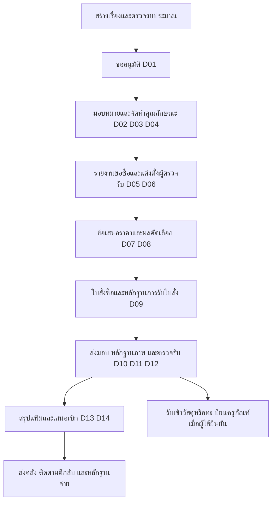

# วิเคราะห์กระบวนงานจัดซื้อจัดจ้างจากไฟล์ตัวอย่าง

วันที่วิเคราะห์ 15 พฤศจิกายน 2569

หมายเหตุขอบเขตล่าสุด: เอกสารนี้เป็นผลอ่านชุดไฟล์เก่า รหัส D10 เดิมหมายถึงรูปพัสดุ ต่อมาผู้ใช้ชี้แจงว่า D05–D11 มีข้อมูลต้นทาง e-GP และเลือกได้รายฉบับว่าจะใช้ไฟล์นั้นหรือร่างเองจากข้อมูล e-GP เพิ่ม D10 ข้อมูลสาระสำคัญ และข้อมูลสัญญา e-GP ที่แสดงใน e-LAAS พร้อมบริหารสัญญาและส่งคลังสองรอบซึ่งจบที่ลงรับรอบสอง ให้ใช้ [ข้อกำหนดพัฒนาฉบับล่าสุด](procurement-implementation-spec.md) หัวข้อ 6/6.1 และ 20–22 เป็นหลักในการลงมือ ไม่ตีความบทวิเคราะห์นี้ว่าต้องสร้างทุกฉบับขึ้นใหม่ ต้องใช้ไฟล์ภายนอกทุกฉบับ หรือรอจ่ายเงินจริงจึงปิดงาน

ข้อเสนอหลักคือเพิ่มโมดูลจัดซื้อจัดจ้างในสารบรรณ โดยให้หนึ่งเรื่องมีข้อมูลกลาง รายการพัสดุ ผู้เกี่ยวข้อง เอกสาร และหลักฐานร่วมกัน แล้วสร้างเอกสารตามขั้นตอนจากข้อมูลนั้น การเปลี่ยนร้านค้า จำนวนเงิน รายการ หรือผู้ลงนามต้องตรวจผลกระทบต่อเอกสารทั้งเรื่องได้ โดยเก็บฉบับที่ออกและลงนามแล้วเป็นประวัติ

ชุดที่ได้รับเหมาะเป็นต้นแบบสำหรับงานซื้อวัสดุสำนักงานโดยวิธีเฉพาะเจาะจงตามข้อความในเอกสาร ข้อมูลมีร่องรอยจากหลายงานและหลายปี จึงใช้ศึกษารูปแบบและความเชื่อมโยงได้ แต่ยังไม่ควรเลือกชื่อร้าน วันที่ ยอดเงิน หรือผู้ตรวจรับชุดใดเป็นค่าจริงโดยอัตโนมัติ

## 1 ขอบเขตและวิธีตรวจ

- ต้นทางคือ `C:\Users\PR-StartUp\Desktop\ตัวอย่างไฟล์งาน` พบไฟล์ระดับเดียว 14 ไฟล์ ไม่มีโฟลเดอร์ย่อย ณ เวลาสำรวจ
- อ่านเนื้อหาเอกสาร .docx 13 ไฟล์ รวมตาราง กล่องข้อความ และหัวท้ายกระดาษจาก OOXML
- อ่านไฟล์ .doc 1 ไฟล์จาก CFB และ Word Clx piece table รวมข้อความส่วนหลักและข้อความในส่วนอื่น เช่น ช่องลงนาม ไม่ใช้ข้อความที่สุ่มพบในไบนารีเป็นหลักฐานสุดท้าย
- ตรวจภาพฝังในเอกสารรูปภาพประกอบ และโครงสร้างกล่องข้อความ/ตาราง
- การดึงข้อความพบ Choice/Fallback สำหรับกล่องข้อความหลายไฟล์ จึงไม่ถือว่าข้อความซ้ำในผลสกัดหมายถึงพิมพ์ซ้ำบนหน้าจริง
- ยังไม่ได้ตรวจหน้าพิมพ์ทุกหน้าของเอกสารต้นฉบับ การเปิดตรวจผ่าน Word UI พบปัญหา helper `FrameArrived timed out` และ `coordinate input geometry is unavailable` จึงใช้การอ่านโครงสร้างไฟล์แทน ไม่มีการรับรองความเหมือนของเค้าโครงในรอบนี้
- ไม่แก้ไฟล์ต้นฉบับ ไม่เปลี่ยนฐานข้อมูลผู้ใช้ ไม่ส่งไฟล์หรือข้อมูลในแฟ้มไปบริการ AI/Drive และไม่เริ่มพัฒนาโมดูลในรอบวิเคราะห์นี้
- บทวิเคราะห์นี้แยกข้อค้นพบจากไฟล์ ข้อเสนอออกแบบ และประเด็นกฎหมายที่ต้องตรวจเพิ่ม ไม่มีการสรุปว่าเอกสารตัวอย่างผิดระเบียบหรือเป็นเอกสารที่ผ่านอนุมัติจริง

## 2 บัญชีเอกสารและแม่แบบ

รหัส D01–D14 ด้านล่างเป็นรหัสวิเคราะห์ ลำดับเลขในชื่อไฟล์มีเลข 1 สองครั้ง จึงไม่ใช้ชื่อไฟล์เป็นรหัสเอกสารหรือเครื่องตัดสินลำดับตามกฎหมาย

| รหัส | ไฟล์ต้นทาง | หน้าที่ในเรื่อง | ข้อมูลที่ควรดึงจากข้อมูลกลาง |
| --- | --- | --- | --- |
| D01 | [บันทึกขออนุมัติ](<C:/Users/PR-StartUp/Desktop/ตัวอย่างไฟล์งาน/1.บันทึกข้อความ ขออนุมัติจัดซื้อจัดจ้าง 1439.docx>) | แจ้งความจำเป็นและขออนุมัติดำเนินการ | เรื่อง หน่วยงาน เหตุผล แหล่งงบประมาณ จำนวนรายการ เลข/วันที่ ผู้เสนอ และสายความเห็น |
| D02 | [มอบหมายกำหนดคุณลักษณะ](<C:/Users/PR-StartUp/Desktop/ตัวอย่างไฟล์งาน/1.มอบหมาย 1446.docx>) | ระบุผู้รับผิดชอบกำหนดคุณลักษณะ | ผู้ได้รับมอบหมาย ตำแหน่ง หน้าที่ เรื่อง งบประมาณ เลข/วันที่ ผู้ลงนาม |
| D03 | [รายงานคุณลักษณะ](<C:/Users/PR-StartUp/Desktop/ตัวอย่างไฟล์งาน/3.กำหนดคุณลักษณะ 1447.docx>) | รายงานผลจัดทำคุณลักษณะและเสนอใช้ | อ้างอิง D02 ขอบเขตผลการจัดทำ ผู้จัดทำ เอกสาร TOR แนบ และผู้เห็นชอบ |
| D04 | [TOR](<C:/Users/PR-StartUp/Desktop/ตัวอย่างไฟล์งาน/4.TOR.docx>) | คุณลักษณะ เงื่อนไขส่งมอบ งบประมาณ และเกณฑ์คัดเลือก | รายการ/จำนวน/หน่วย คุณลักษณะ ระยะเวลา จุดเริ่มนับวัน สถานที่ส่งมอบ ค่าปรับ และงบประมาณ |
| D05 | [รายงานขอซื้อในไฟล์ชื่อรายงานขอจ้าง](<C:/Users/PR-StartUp/Desktop/ตัวอย่างไฟล์งาน/5.รายงานขอจ้าง.docx>) | รายงานเหตุผล รายละเอียด ราคา วงเงิน วิธี และเสนอผู้ตรวจรับ | รายการ ราคากลาง วงเงิน งบคงเหลือ กำหนดใช้ เหตุผลเลือกวิธี และผู้ตรวจรับที่เสนอ |
| D06 | [คำสั่งแต่งตั้ง](<C:/Users/PR-StartUp/Desktop/ตัวอย่างไฟล์งาน/6.คำสั่ง รอออกเลขคำสั่ง.doc>) | แต่งตั้งผู้ตรวจรับและกำหนดหน้าที่ | เลข/วันที่คำสั่ง ผู้ได้รับแต่งตั้ง ตำแหน่ง อำนาจหน้าที่ และผู้มีอำนาจลงนาม |
| D07 | [รายงานพิจารณาผล](<C:/Users/PR-StartUp/Desktop/ตัวอย่างไฟล์งาน/7.รายงานพิจารณาผล.docx>) | สรุปผู้เสนอราคาและขออนุมัติสั่งซื้อ | ผู้ยื่นข้อเสนอ ราคาที่เสนอ ราคาที่ตกลง ฐานภาษี ภาษี รวมเงิน เกณฑ์ และผลอนุมัติ |
| D08 | [ประกาศผู้ชนะ](<C:/Users/PR-StartUp/Desktop/ตัวอย่างไฟล์งาน/8.ประกาศผู้ชนะ  ยังไม่แก้.docx>) | ประกาศผลคัดเลือก | เรื่อง ผู้ได้รับคัดเลือก ยอดที่ตกลง วันที่ประกาศ และผู้ลงนาม |
| D09 | [ใบสั่งซื้อในไฟล์ชื่อใบสั่งจ้าง](<C:/Users/PR-StartUp/Desktop/ตัวอย่างไฟล์งาน/9.ใบสั่งจ้าง.docx>) | กำหนดข้อตกลงซื้อและส่งมอบ | เลขที่ ผู้ขาย ที่อยู่ ภาษี รายการ ราคา กำหนดส่ง สถานที่ เงื่อนไข ผู้สั่ง/ผู้รับใบสั่ง และวันลงนาม |
| D10 | [รูปภาพประกอบ](<C:/Users/PR-StartUp/Desktop/ตัวอย่างไฟล์งาน/10.รูปภาพประกอบ.docx>) | หลักฐานภาพและการรับรอง | ภาพที่ผูกกับเรื่อง/รายการ/การส่งมอบ คำบรรยาย วันที่ และผู้รับรอง |
| D11 | [ใบตรวจรับ](<C:/Users/PR-StartUp/Desktop/ตัวอย่างไฟล์งาน/11.ใบตรวจรับการจัดซื้อ(ปริ้น2ชุด).docx>) | บันทึกผลตรวจรับและค่าปรับ | ใบสั่งอ้างอิง วันตรวจรับ ผลถูกต้อง/ครบถ้วน ค่าปรับ และผู้ตรวจรับ จำนวนชุดพิมพ์ |
| D12 | [รายงานผลตรวจรับ](<C:/Users/PR-StartUp/Desktop/ตัวอย่างไฟล์งาน/12.รายงานผลการตรวจรับพัสดุ.docx>) | รายงานผลตรวจรับต่อผู้บังคับบัญชา | คำสั่ง ใบสั่ง คู่สัญญา กำหนดส่ง วันส่งจริง วันตรวจรับ ผลตรวจรับ ยอดเสนอเบิก และผู้ตรวจรับ |
| D13 | [รายงานวิธีการและหลักฐาน](<C:/Users/PR-StartUp/Desktop/ตัวอย่างไฟล์งาน/13.รายงานผลการพิจารณารายละเอียดวิธีการ.docx>) | สรุปกระบวนการพร้อมรายการหลักฐาน | ลำดับเหตุการณ์ เลข/วันที่เอกสาร คู่สัญญา เงิน และสารบัญหลักฐานที่มีจริง |
| D14 | [บันทึกขอเบิกเงิน](<C:/Users/PR-StartUp/Desktop/ตัวอย่างไฟล์งาน/14.บันทึกข้อความอนุมัติเบิกเงิน.docx>) | เสนออนุมัติเบิกและลงนามเอกสารการเงิน | ปีงบประมาณ ตั้งไว้/โอน/ใช้แล้ว/คงเหลือ ผู้รับเงิน ยอดเบิก หลักฐาน และผู้เสนอ/ลงนาม |

จัดเป็น 7 กลุ่มแม่แบบได้ คือบันทึกข้อความ 8 ฉบับ และแบบเฉพาะอีก 6 กลุ่ม ได้แก่ TOR คำสั่ง ประกาศ ใบสั่งซื้อ/จ้าง ภาพประกอบ และใบตรวจรับ การใช้กลไกจัดหน้าและช่องลงนามร่วมกันจึงทำได้มากกว่าการสร้างฟอร์มแยกอิสระ 14 ชุด

## 3 ผังกระบวนงานที่เสนอจากชุดตัวอย่าง

นี่เป็นผังออกแบบจากตัวอย่าง ไม่ใช่การรับรองลำดับบังคับสำหรับทุกวิธีจัดซื้อจัดจ้าง ความสัมพันธ์ของขั้นตอน วันที่ และข้อยกเว้นต้องผูกกับวิธีและกรณีที่รองรับจริง

การออกเอกสาร การลงนาม การส่งของ การตรวจรับ และการจ่ายเงินเป็นเหตุการณ์คนละชนิด การสร้าง PDF หรือกดตรวจทานครบต้องไม่เปลี่ยนสถานะเป็นอนุมัติ ลงนาม ตรวจรับ หรือจ่ายเงินสำเร็จแทนหลักฐานจริง

## 4 จุดที่พบและสิ่งที่ระบบควรช่วยตรวจ

| ประเด็น | ข้อค้นพบจากตัวอย่าง | ผลต่อการออกแบบ |
| --- | --- | --- |
| ประเภทซื้อ/จ้าง | D05 และ D09 ใช้ชื่อไฟล์จ้าง แต่เนื้อหาเป็นงานซื้อ บางประโยคยังใช้คำว่าจ้าง | เก็บประเภทงานเป็นข้อมูลกลาง และเลือกข้อความ/เงื่อนไขตามประเภท ตรวจคำปะปนพร้อมให้เจ้าหน้าที่ทบทวน ไม่ใช้แทนคำทั้งไฟล์แบบอัตโนมัติ |
| จำนวนรายการ | D01 D10 และ D14 กล่าวถึง 4 รายการ ขณะที่ TOR และรายงานหลักระบุ 2 รายการ | จำนวนรายการคำนวณจากรายการที่เลือก; แยกจำนวนแถวออกจากจำนวนชิ้น |
| ปริมาณ | TOR ระบุกล่อง 2 ใบ และตลับเมตร 1 ตลับ | เก็บรายการ จำนวน และหน่วยแยก ไม่ใช้เลข 2 เป็นจำนวนรวมทุกความหมาย |
| คู่สัญญา | D07 D08 ระบุร้านหนึ่ง แต่ D09 D12 D13 D14 ระบุบริษัทอีกแห่ง | เลือกผู้ได้รับคัดเลือกจากข้อเสนอของเรื่องเดียวกัน และคัดลอกเป็นข้อมูลคู่สัญญาของเรื่อง |
| ยอดเงิน | TOR D05 D07 D09 D12 D13 ใช้ 1,520 บาท แต่ D14 ใช้ 1,366 บาท | แยกราคาประมาณการ ยอดที่ตกลง ยอดบิล ยอดเบิก และยอดสุทธิ; หากต่างต้องมีรายการอธิบาย ไม่เดาว่าเป็นภาษีหัก ณ ที่จ่าย |
| ฐานและภาษี | D07 D09 แสดงฐาน 1,420.56 + ภาษี 99.44 = 1,520.00 | ใช้เครื่องคำนวณชุดเดียวและนโยบายปัดเศษชัดเจน แยกราคารวม/ไม่รวมภาษี และไม่อนุมานสถานะภาษีจากประเภทงาน |
| ปีและวันที่ | พบปีเอกสาร 2568/2569 และปีงบประมาณ 2568/2570 ปะปน; วันที่รายงานขอซื้อเป็น 12 พ.ย. 2569 แต่มอบหมายและรายงานคุณลักษณะเป็น 13 พ.ย. 2569 | แยกปีงบประมาณออกจากปีเอกสาร บันทึกวันที่รายเหตุการณ์ และแจ้งวันที่ที่ขัดกับกระบวนงานที่เลือก โดยไม่แก้วันที่ต้นฉบับให้เอง |
| งบประมาณ | TOR D05 มีตั้งไว้ 30,000 คงเหลือก่อนงาน 1,562 ขณะที่ D14 แสดงคงเหลือ 30,000 | เก็บยอด ณ วันที่อ้างอิงและแหล่งข้อมูล แยกการประมาณยอดจากข้อมูลบัญชีที่หน่วยงานรับรอง; 1,562-1,520=42 เป็นเพียงผลคำนวณจากตัวอย่าง |
| ผู้ตรวจรับ | D05 D06 D11 ระบุผู้ตรวจรับคนหนึ่ง แต่ชื่อผู้ลงนามใน D12 เป็นอีกคน | เชื่อมผู้ตรวจรับกับคำสั่งแต่งตั้งและวันมีผล แยกผู้จัดทำรายงานจากผู้ตรวจรับ ไม่ใช้ชื่อผู้ร่างแทนผู้ตรวจรับ |
| เงื่อนไขส่งมอบ | TOR นับถัดจากวันลงนาม แต่ใบสั่งมีทั้งวันได้รับใบสั่งและวันลงนาม | เก็บจำนวนวัน หน่วยนับ จุดเริ่มนับ และวันเริ่มจริงแยกกัน ตรวจข้อความเงื่อนไขในทุกฉบับ |
| ราคาต่อรายการ | D09 สรุปรวมเรื่อง ไม่แสดงราคาต่อชิ้นของกล่องและตลับเมตรแยกรายการ | ต้องกรอก/นำเข้าราคาต่อรายการหรือเลือกแสดงยอดเหมารวมตามหลักฐานจริง ห้ามย้อนหาราคาต่อชิ้นเอง |
| ภาพประกอบ | D10 มีภาพสินค้าอื่น เช่น กระดาษ ปก และอุปกรณ์กาว ต่างจากรายการกล่องและตลับเมตรใน TOR | ผูกภาพกับรายการ/งวดส่งมอบ และให้ตรวจยืนยันก่อนรวมแฟ้ม ภาพช่วยตรวจหลักฐานแต่ไม่ยืนยันปริมาณหรือคุณลักษณะได้เอง |
| ข้อความตกค้าง | หลายไฟล์มี footer เรื่องซ่อมคอมพิวเตอร์และเดือน ก.ค. 2569 | ตรวจข้อความทั้ง body/header/footer/textbox ก่อนรับเป็นแม่แบบ ข้อความที่มีอยู่ใน XML อาจไม่แสดงทุกหน้า ต้องตรวจภาพหน้าพิมพ์ด้วย |
| ตัวอักษรจำนวนเงิน | D05 มีคำอ่านจำนวนเงินที่สะกดไม่ตรงรูปมาตรฐาน | สร้างคำอ่านจากยอดตัวเลขเดียวกันและให้ตรวจทาน ไม่พิมพ์ซ้ำแยกช่องโดยไม่มีการเทียบ |

ไม่เลือกข้อมูลชุดที่ดูใหม่ที่สุดมาแก้ทับชุดอื่น เพราะอาจเป็นคนละงานกัน สถานะของแฟ้มตัวอย่างควรเป็น “ชุดอ้างอิงแม่แบบ” ไม่ใช่งานจัดซื้อจริงที่นำเข้าพร้อมประกาศว่าพร้อมเบิก

## 5 ข้อมูลกลางที่ควรมี

### ข้อมูลองค์กรและเรื่อง

ชื่อองค์กร กอง/งาน ที่อยู่ โทรศัพท์ รหัสหนังสือ ชื่อเรื่อง ประเภทซื้อหรือจ้าง วิธีดำเนินการ เหตุผลความจำเป็น วัตถุประสงค์ ปีงบประมาณ โครงการที่เกี่ยวข้อง ผู้รับผิดชอบ และข้อความอ้างอิงกฎหมายที่ผ่านตรวจแล้ว

### งบประมาณและราคา

แผนงาน งาน งบ หมวด ประเภท รายการงบ ตั้งไว้ โอนเพิ่ม/ลด ใช้แล้ว ผูกพันแล้ว คงเหลือ แหล่งอ้างอิงและวันที่ตรวจยอด ราคากลาง วงเงินอนุมัติ ราคาที่เสนอ ราคาที่ตกลง ยอดรับมอบ ยอดบิล ยอดเบิก ภาษี รายการหัก และยอดสุทธิ แยกตามความหมาย ไม่ใช้ช่อง “จำนวนเงิน” ช่องเดียวครอบทุกขั้นตอน

งบในระบบสารบรรณไม่ใช่ข้อมูลคงเหลือจาก e-LAAS โดยอัตโนมัติ จึงต้องระบุว่าเจ้าหน้าที่กรอกจากหลักฐานใดและตรวจล่าสุดเมื่อใด

### รายการพัสดุหรืองานจ้าง

รหัสรายการภายใน ชื่อ รายละเอียด/คุณลักษณะ จำนวน หน่วย ราคาต่อหน่วย ส่วนลด ฐานภาษี ยอดรวม หมวดวัสดุ/ครุภัณฑ์ และเลขครุภัณฑ์เดิมถ้าเป็นงานซ่อม รายการมีรหัสคงที่เพื่อเชื่อมข้อเสนอ ใบสั่ง การส่งมอบ ภาพ และการรับเข้าคลัง

### ร้านค้าและข้อเสนอ

ทะเบียนร้านค้าบันทึกชื่อ ประเภทผู้ประกอบการ เลขผู้เสียภาษี สาขา ที่อยู่ ผู้ติดต่อ ช่องทางติดต่อ สถานะภาษี และข้อมูลรับเงินตามที่ต้องใช้ แต่ข้อเสนอราคาแต่ละงานต้องแยกผู้เสนอ วันที่ เลขที่ ราคาต่อรายการ เงื่อนไข และไฟล์หลักฐาน ไม่ผูกเรื่องกับร้านผู้ชนะก่อนมีผลคัดเลือก

เลือกผู้ได้รับคัดเลือกแล้วเก็บสำเนาข้อมูลผู้ขายไว้กับเรื่อง การแก้ชื่อหรือที่อยู่ในทะเบียนร้านค้าภายหลังต้องไม่เปลี่ยนเอกสารที่ออกแล้ว

### บุคลากรและบทบาท

ผู้ขอ/ผู้จัดทำ ผู้กำหนดคุณลักษณะ เจ้าหน้าที่ หัวหน้าเจ้าหน้าที่ ผู้เสนอความเห็น ผู้มีอำนาจอนุมัติ ผู้สั่งซื้อ ผู้รับใบสั่ง ผู้ตรวจรับหรือคณะกรรมการ ผู้รับรองภาพ และผู้จัดทำเบิก แยกชื่อ ตำแหน่ง ข้อความรักษาราชการ/ปฏิบัติราชการแทน และเอกสารอ้างอิงอำนาจ

รองรับคณะกรรมการหลายคนและบทบาทหลายประเภท ไม่กำหนดว่าทุกงานต้องเป็นผู้ตรวจรับคนเดียว หรือทุกบทบาทต้องเป็นคนละคน โดยยังไม่ตรวจเงื่อนไขที่เกี่ยวข้อง

### วันที่และเลขอ้างอิง

วันขออนุมัติ มอบหมาย รายงานคุณลักษณะ รายงานขอซื้อ แต่งตั้ง ใบเสนอราคา อนุมัติผล ประกาศ ลงนามใบสั่ง รับใบสั่ง กำหนดส่ง ส่งจริง บิล ตรวจรับ เสนอเบิก ส่งคลัง ตีกลับ ส่งซ้ำ และจ่ายจริง แยกจากกัน

เลขหนังสือ เลขคำสั่ง เลขใบสั่ง เลขบิล เลขคุมตรวจรับ เลขโครงการ/คุมสัญญา e-GP และเลขฎีกา e-LAAS เป็นเลขคนละระบบ เลขในระบบนี้เป็นข้อมูลอ้างอิง ไม่จองเลขใน e-GP/e-LAAS แทนระบบนั้น

จัดเก็บวันที่เป็น ISO ค.ศ. และแสดงเป็น พ.ศ. ตามรูปแบบเอกสาร เก็บปีงบประมาณเป็นข้อมูลเฉพาะ หลีกเลี่ยงบวก 543 ซ้ำและไม่ถือว่าปีงบประมาณต้องเท่ากับปีวันที่หนังสือ

## 6 วิธีสร้างและดูแลแม่แบบ

แนะนำใช้ข้อมูลกลางร่วมกับเครื่องจัดหน้าเดิมของสารบรรณ แล้วเพิ่มแบบเฉพาะงานจัดซื้อจัดจ้าง

1. บันทึกข้อความใช้รูปแบบเดิมและช่องความเห็น/ลงนามเดิม โดยเพิ่มตัวสร้างเนื้อหาตาม D01 D02 D03 D05 D07 D12 D13 D14
2. คำสั่งและประกาศใช้ประเภทเอกสารเดิมที่มีอยู่ แล้วเพิ่มข้อมูลการแต่งตั้ง/ผลคัดเลือก
3. TOR ใบสั่งซื้อ ใบตรวจรับ และหน้ารูป ใช้ตัวสร้างเฉพาะที่รับข้อมูลโครงสร้างเดียวกัน พร้อมตาราง/ช่องเลือก/ภาพและลายเซ็น
4. เตรียมเอกสารต้นฉบับให้เป็นแม่แบบสะอาด ตรวจคำเก่า หัวท้าย และกล่องข้อความ แปลง .doc เป็น .docx สำเนาเมื่อต้องใช้เป็นแม่แบบจริง โดยคงไฟล์อ้างอิงเดิม
5. กำหนดเลขรุ่นแม่แบบ รายการช่องบังคับ ข้อความประจำแบบ และช่องที่อนุญาตแก้เป็นรายเรื่อง
6. ป้องกันชื่อ/วันที่/เงินว่างด้วยการแสดงจุดที่ขาดในฉบับร่าง และกั้นการออกฉบับจริงเมื่อข้อมูลจำเป็นไม่ครบ แยกปุ่มออกฉบับร่างจากปุ่มออกฉบับพร้อมลงนาม
7. เทียบ A4/PDF/Word กับต้นแบบที่ตรวจแล้ว ทั้งกรณีข้อความสั้น ยาว หลายรายการ และหลายผู้ลงนาม

ไฟล์ .docx ทั้ง 13 ไฟล์ยังไม่พบ content controls ในผลตรวจครั้งนี้ จึงไม่ใช่แม่แบบที่มีชื่อช่องพร้อมแทนค่าทันที การแทน string ทั่วไปเสี่ยงแทนผิดจุดและพลาดข้อความที่ Word แบ่งเป็นหลาย run

ระบบนำเข้า Word เดิมรองรับบันทึกข้อความ/หนังสือภายในและจัดหน้าใหม่ ไม่ใช่เครื่องสร้างแม่แบบจัดซื้อครบทุกชนิด การนำเข้าต้นฉบับกับการสร้างเอกสารจากแม่แบบควรเป็นงานคนละขั้นตอน

หากต้องคงเค้าโครง Word ต้นฉบับอย่างเคร่งครัด ควรเพิ่มทางเลือก DOCX template ที่ทำช่องไว้ล่วงหน้า และมีระบบแปลง PDF ที่ตรวจบนเครื่องเป้าหมายก่อน ไม่ควรสมมติว่า PDF จากเครื่องจัดหน้าเดิมจะตรง Word ทุกจุดโดยไม่เทียบภาพ

## 7 การแก้ข้อมูลและรักษาประวัติ

เอกสารที่สร้างแต่ละครั้งควรเก็บรหัสเรื่อง รุ่นข้อมูลกลาง รหัส/รุ่นแม่แบบ สำเนาข้อมูลที่ใช้สร้าง และ hash ไฟล์

- เอกสารร่างสามารถสร้างใหม่จากข้อมูลกลางได้ แต่ถ้ามีผู้ใช้แก้เฉพาะฉบับ ให้แสดงความต่างและเลือกรวมการแก้
- เมื่อแก้ร้านค้า/จำนวนเงิน/ผู้ตรวจรับ ให้แสดงรายการเอกสารที่ได้รับผลกระทบ เช่น D07 D08 D09 D12 D13 D14
- เอกสารที่ออกหรือมีฉบับลงนามแล้วเก็บเดิม การเปลี่ยนข้อมูลสร้างรุ่นแก้ไขและบันทึกเหตุผล
- สถานะเอกสารแยกเป็น ร่าง ตรวจทาน ออกฉบับ เก็บฉบับลงนาม ยกเลิก/แทนที่ โดยทุกสถานะสะท้อนสิ่งที่เจ้าหน้าที่บันทึกพร้อมหลักฐาน
- สถานะเรื่อง เช่น เตรียมเรื่อง รอข้อเสนอ รออนุมัติ รอส่งมอบ รอตรวจรับ รอหลักฐาน พร้อมส่งคลัง ส่งคลัง ถูกตีกลับ จ่ายแล้ว และปิดเรื่อง แยกจากสถานะเอกสาร
- การทำเครื่องหมายครบใน checklist ต้องระบุได้ว่าผ่านด้วยเอกสารใดหรือยกเว้นเพราะเหตุใด ไม่ใช้เปอร์เซ็นต์ความคืบหน้าแทนการตรวจหลักฐาน
- การบันทึกซ้ำหลังเครือข่ายสะดุด การสร้างใบสั่งซ้ำ และการรับเข้าคลังซ้ำต้องไม่สร้างรายการจริงซ้ำ

## 8 หน้าจอที่เสนอ

เพิ่มเมนู “จัดซื้อจัดจ้าง” ใต้กลุ่มงานประจำ เชื่อมกับงานของฉันและโครงการได้

หน้ารวมแสดงงานที่ต้องทำต่อ รอใบเสนอราคา รอส่งของ รอตรวจรับ รอเอกสาร พร้อมส่งคลัง ถูกตีกลับ และใกล้ครบกำหนด ตัวเลขมาจากข้อมูลจริงและนิยามยอดเงินแต่ละชนิดชัดเจน

หน้าเรื่องเดียวมีส่วนหลักดังนี้

| ส่วน | สิ่งที่ผู้ใช้ทำ |
| --- | --- |
| ข้อมูลเรื่องและงบ | กรอกเหตุผล ปีงบ แหล่งเงิน โครงการ และยอดที่ตรวจจากหลักฐาน |
| รายการและข้อเสนอ | เพิ่มรายการ เปรียบเทียบข้อมูลผู้เสนอ และระบุผลคัดเลือก |
| ผู้เกี่ยวข้อง | เลือกบทบาท สายความเห็น ผู้ลงนาม และผู้ตรวจรับ |
| ขั้นตอนและเอกสาร | เห็นสิ่งที่ขาด สร้างทีละฉบับ ดู A4 แก้ข้อความเฉพาะ และพิมพ์/ส่งออก |
| ส่งมอบและตรวจรับ | บันทึกส่งจริง ผลรับมอบ ค่าปรับ ภาพและไฟล์ลงนาม |
| ส่งเบิกและประวัติ | ตรวจชุดหลักฐาน สร้างสารบัญ ส่งคลัง บันทึกตีกลับ ส่งใหม่ และยืนยันการจ่ายจากหลักฐาน |

รองรับบันทึกร่างโดยยังกรอกไม่ครบ และทำงานออฟไลน์ในส่วนหลัก การส่ง Drive ทำตามคำสั่งและสถานะการเชื่อมต่อเดิม

## 9 กฎตรวจที่ทำได้และสิ่งที่ยังต้องตรวจระเบียบ

### ตรวจความสอดคล้องของข้อมูลได้โดยตรง

- เลขอ้างอิง ชื่อคู่สัญญา รายการ ผู้ตรวจรับ และยอดที่อ้างต้องเชื่อมกับเอกสาร/เหตุการณ์ที่ถูกต้อง
- ยอดคูณ/รวม ภาษีและรายการหักคำนวณตามนโยบายทศนิยมเดียวกัน ใช้จำนวนสตางค์หรือเลขฐานสิบที่กำหนดชัดเจน ไม่ใช้ผลลัพธ์ floating point ดิบเป็นยอดเงิน
- ตรวจจำนวนส่งมอบกับจำนวนสั่งและจำนวนที่ตรวจรับ แต่รองรับการตรวจรับบางส่วนหรือส่งแก้ตามเงื่อนไขที่อนุมัติให้ใช้
- ตรวจหลักฐานภาพ ไฟล์ลงนาม และรายการเอกสารขาดตาม workflow ที่เลือก
- แจ้งการอ้างเลขเก่า ผู้ลงนามไม่ตรงการแต่งตั้ง และเอกสารที่ล้าสมัยหลังแก้ข้อมูลกลาง
- วันที่ขัดกันให้บอกเหตุการณ์คู่ที่ขัดและที่มาของกฎ ห้ามใช้ลำดับวันแบบเดียวบังคับทุกกรณี

### ต้องตรวจแหล่งราชการและเงื่อนไขก่อนเป็นกฎบล็อก

วิธีดำเนินการตามวงเงิน/ประเภทงาน การแต่งตั้งผู้ตรวจรับหรือคณะกรรมการ อำนาจอนุมัติ ข้อยกเว้น/การบันทึกใน e-GP การเผยแพร่ประกาศ หลักฐานการเงิน ภาษี อากร ค่าปรับ เงื่อนไขจ้างช่วง และการนับกำหนดวัน

การตรวจแหล่งอ้างอิงเบื้องต้นพบว่า

- กฎกระทรวง พ.ศ. 2560 แยกเรื่องวงเงินใช้วิธีเฉพาะเจาะจง การทำข้อตกลงเป็นหนังสือ และการแต่งตั้งผู้ตรวจรับเป็นคนละข้อ จึงไม่ควรรวมเป็นเงื่อนไขวงเงินช่องเดียว [ราชกิจจานุเบกษา ตัวบทกฎกระทรวง](https://ratchakitcha.soc.go.th/documents/2117208.pdf)
- ข้อ 79 วรรคสองกล่าวถึงความจำเป็นเร่งด่วนที่เกิดโดยไม่คาดหมายและดำเนินการตามปกติไม่ทัน การออกแบบทางลัดเร่งด่วนจึงต้องเก็บเหตุและหลักฐาน ไม่เลือกจากยอดต่ำอย่างเดียว [ตัวบทที่เผยแพร่โดยกรมควบคุมโรค](https://cpb.ddc.moph.go.th/ddc-pic/law/reg-2560/79)
- ข้อ 175 มีเนื้อหาเรื่องหลักฐานตรวจรับและกรณีส่งมอบบางส่วน จึงควรออกแบบข้อมูลให้เก็บผลตามรายการ/ครั้งรับมอบได้ [ตัวบทข้อ 175 ที่เผยแพร่โดยกรมควบคุมโรค](https://cpb.ddc.moph.go.th/ddc-pic/law/reg-2560/175)
- พบรายการหนังสือเวียน ว 714 ลงวันที่ 16 กันยายน 2569 เรื่องแนวทางยื่นข้อเสนอวิธีคัดเลือกและเฉพาะเจาะจงผ่าน e-GP ในเว็บไซต์กรมบัญชีกลาง แต่ยังไม่ได้อ่านไฟล์แนบฉบับเต็ม จึงยังไม่สรุปขอบเขตการใช้กับงานตัวอย่าง [รายการหนังสือเวียนกรมบัญชีกลาง](https://www.cgd.go.th/cs/cnt/cnt/หนังสือเวียน.html?page=1&page_locale=en_US&perpage=100)

รอบนี้ยังไม่ได้ตรวจหนังสือเวียน/ฉบับแก้ไขทั้งหมด คำสั่งมอบอำนาจของเทศบาล และข้อกำหนดรับเอกสารของกองคลัง จึงยังไม่กำหนดอัตราภาษี วงเงิน หรือค่าปรับเป็นกฎใช้จริง แต่ละกฎในระบบควรมีแหล่งอ้างอิง ขอบเขต วันที่เริ่มใช้ วันที่ทบทวน และระดับ “เตือน” หรือ “บล็อก”

## 10 เอกสารและข้อมูลที่ยังไม่พบในโฟลเดอร์นี้

ยังไม่พบไฟล์แยกสำหรับใบเสนอราคาจริง ใบส่งของ/ใบแจ้งหนี้/ใบกำกับภาษี ใบเสร็จ เอกสารคู่สัญญา หลักฐานอำนาจลงนาม เลข/ผลจาก e-GP ฎีกาหรือหลักฐานจาก e-LAAS และหลักฐานจ่ายเงินจริง

การไม่พบในโฟลเดอร์นี้ไม่ได้แปลว่าเจ้าหน้าที่ไม่มีเอกสารเหล่านั้น ระบบควรมีช่องแนบและบันทึกสถานะตามความจำเป็นของแต่ละกรณี ไม่สร้างเอกสารภายนอกหรือสถานะสำเร็จให้เอง

ชุดนี้ยังไม่มีตัวอย่างครบสำหรับงานซ่อม งานจ้างบริการ งานก่อสร้าง วิธีอื่น การส่งมอบหลายงวด หรือกรณีเร่งด่วน จึงยังไม่ควรสรุปว่าครอบคลุมงานจัดซื้อจัดจ้างทุกประเภท

## 11 การต่อกับโค้ดสารบรรณเดิม

| ส่วนเดิม | สิ่งที่ใช้ต่อได้ | ส่วนที่ต้องเพิ่มหรือตรวจ |
| --- | --- | --- |
| `src/lib/document.ts` และ `templates.ts` | แบบบันทึก คำสั่ง ประกาศ ช่องความเห็น ข้อมูลเอกสาร | ตัวสร้างเอกสารจากเรื่องจัดซื้อและความเชื่อมโยงรุ่น ไม่ใส่ข้อมูลกระบวนงานทั้งหมดในช่อง body |
| `render-document.ts`, `pdf.ts`, `word.ts` | A4 จัดหน้า PDF และ Word | TOR ใบสั่ง ใบตรวจรับ หน้าภาพ และการทดสอบเนื้อหา/จัดหน้าตรงกัน |
| `inventory-form-render.ts`, `inventory-pdf.ts`, `renderWordHtml` | ตัวอย่างการส่งออกแบบเฉพาะจาก HTML | ใช้เป็นแนวทางสร้างแบบจัดซื้อ ไม่เพิ่มแบบใหม่ไปปะปนกับทะเบียนคลังโดยไม่มีขอบเขต |
| `src/lib/db.ts` | SQLite transaction, version, audit และตรวจเลขหนังสือ | schema ใหม่ ดัชนี ความสัมพันธ์ และเลขคำสั่ง/ใบสั่งตามขอบเขตหน่วยงาน |
| `inventory.ts` และ `inventory-db.ts` | รายการวัสดุ ครุภัณฑ์ และรับเข้าคลัง | รายการจัดซื้อก่อนรับจริงแยกจากยอดคลัง เชื่อมรับเข้าหลังยืนยันและกันรับซ้ำ |
| `office.ts`, `project.ts`, ระบบ task-alert | งาน โครงการ วันครบกำหนดและเตือน | ผูกเรื่องจัดซื้อกับงาน/โครงการเดิม ไม่สร้างงานซ้ำโดยอัตโนมัติทุกครั้งที่เปิด |
| `organization-directory.ts` | ข้อมูลองค์กรและหน่วยงาน | ยังไม่ใช่ทะเบียนร้านค้าหรือทะเบียนบุคลากรตามบทบาท ต้องเพิ่มข้อมูลแยก |
| ระบบแนบ/ภาพ/ฉบับลงนาม | โครงแบบเก็บไฟล์ BLOB และ metadata | หลักฐานที่เป็นของเรื่อง/งวด/บิล และเอกสารเฉพาะ ต้องมี owner ชัดเจน |
| `scripts/workspace-backup.mjs` | ส่งออกข้อมูลธุรกิจและไฟล์ | รายชื่อตารางกำหนดไว้ ต้องเพิ่มตาราง/ไฟล์ของโมดูลใหม่อย่างชัดเจน |
| `src/lib/workspace-restore.ts` | ตรวจ schema ความสัมพันธ์ fingerprint และกู้คืน | เพิ่ม trusted schema/validation/ลำดับกู้คืน/ความเข้ากันได้กับชุดเก่า |
| `scripts/workspace-files.mjs` | แฟ้มรายเรื่องและ manifest | เพิ่มเจ้าของชนิด procurement และข้อมูล/เอกสาร/บิล/ลงนาม/ภาพ |
| `scripts/dossier-sync-plan.mjs` | แผนซิงก์และ fingerprint ต่อ owner | เพิ่มชนิด owner ความสัมพันธ์ไฟล์และการตรวจข้อมูลเปลี่ยนก่อนส่ง |
| export/update/portable | ชุดย้ายเครื่องและอัปเดตเดิม | ทดสอบว่าข้อมูลและแม่แบบรุ่นที่งานเก่าใช้ติดไปครบ |

ประเด็นสำคัญคือการเพิ่มตารางใน SQLite เพียงอย่างเดียวจะยังไม่ทำให้ข้อมูลใหม่อยู่ในชุดสำรองธุรกิจหรือแฟ้ม Drive เพราะระบบเดิมกำหนดรายชื่อตารางและชนิดเจ้าของไว้

## 12 โครงสร้างข้อมูลที่เสนอ

ชื่อและการแยกตารางเป็นข้อเสนอสำหรับเริ่มออกแบบ ไม่ใช่ migration ที่ถูกสร้างแล้ว

| กลุ่มข้อมูล | หน้าที่ |
| --- | --- |
| `procurement_cases` | เรื่อง ประเภท วิธี ปีงบ แหล่งเงิน รายการพัสดุ บทบาท ข้อความเฉพาะ projectId สถานะและ version |
| `procurement_vendors` | ทะเบียนร้านค้า ข้อมูลติดต่อ/ภาษี/รับเงิน พร้อม version |
| `procurement_people` | บุคลากร ตำแหน่ง และข้อมูลช่วยเลือกบทบาท โดยเก็บสำเนาที่ใช้จริงในเรื่อง |
| `procurement_offers` | ผู้เสนอ เอกสารเสนอราคา ราคาและเงื่อนไขรายรายการ ผลคัดเลือก |
| `procurement_documents` | ชนิดเอกสาร ร่างเดิมที่เชื่อม รุ่นข้อมูล/แม่แบบ snapshot hash เลข/วันที่ และสถานะฉบับ |
| `procurement_files` | ต้นฉบับหลักฐาน owner เรื่อง/เอกสาร/รายการ/งวด/บิล MIME ขนาด hash และไบนารี |
| `procurement_checklist` | งาน/หลักฐานที่ต้องตรวจ ผลตรวจ ผู้บันทึก เอกสารอ้างอิง และเหตุยกเว้น |
| `procurement_deliveries` | ส่งมอบ/ตรวจรับแต่ละครั้ง ปริมาณ ผล ค่าปรับ เอกสารและผู้ตรวจรับ |
| `procurement_payments` | บิล ยอดเสนอเบิก การส่งคลัง ตีกลับ ส่งซ้ำ ยอดหัก สุทธิ และหลักฐานจ่าย |
| `procurement_events` | ประวัติการเปลี่ยนแปลง การออกฉบับ เปลี่ยนสถานะ และ snapshot ที่เกี่ยวข้อง |

ช่วงแรกเก็บรายการและบทบาทเป็นข้อมูลโครงสร้างภายใน case snapshot ที่มีรหัสรายการคงที่ได้ แล้วแยกตารางรายการเมื่อจำเป็นต่อการค้นหา/รายงาน ไม่จำเป็นต้องสร้างฐานข้อมูลซับซ้อนก่อนพิสูจน์กระบวนงานหนึ่งเรื่อง

หากเอกสารชนิดใดใช้ตาราง documents เดิม ให้เก็บเนื้อหาหลักเพียงแห่งเดียวและมีตารางเชื่อม/ข้อมูลรุ่น หลีกเลี่ยงเก็บไฟล์และสถานะซ้ำหลายชุดโดยไม่ระบุว่าชุดไหนเป็นต้นทาง

## 13 แผนพัฒนาเป็นช่วง

### ช่วง 1 ทำชุดแม่แบบและข้อมูลกลางให้ตรงกัน

- ตกลงแม่แบบสะอาดทั้ง 14 ฉบับจากชุดอ้างอิง
- นิยามข้อมูลกลาง รายการ บทบาท วันที่ เลขอ้างอิง และยอดเงินแต่ละชนิด
- เตรียมตัวอย่างจำลองที่มีข้อมูลสอดคล้องกันหนึ่งเรื่อง รวมใบเสนอราคาและหลักฐานประกอบจำลองที่ระบุชัด
- สร้างต้นแบบข้อมูลและทดลองออกเอกสารที่ยาก ได้แก่ ใบสั่งซื้อ รายงานผล และช่องลงนามหลายระดับ

เกณฑ์จบคือสามารถอธิบายที่มาของทุกช่องและเปลี่ยนร้าน/รายการ/ยอด/บุคคลแล้วข้อมูลทุกฉบับตรงกันได้

### ช่วง 2 ทำงานซื้อวัสดุหนึ่งเรื่องให้ครบตั้งแต่เริ่มจนส่งเบิก

เพิ่มเมนู หน้ารวม รายละเอียดเรื่อง รายการ ร้านค้า ผู้เกี่ยวข้อง การสร้างและแก้เอกสารทั้ง 14 ชนิด A4/PDF/Word เอกสารลงนาม และการตรวจความสอดคล้อง

เกณฑ์จบคือสร้างเรื่องใหม่ บันทึก/เปิดใหม่ ส่งออก และรวบรวมเอกสารตามตัวอย่างได้ครบด้วยข้อมูลเดียว โดยการสร้างเอกสารไม่ทำให้สถานะอนุมัติหรือตรวจรับเปลี่ยนเอง

### ช่วง 3 ปิดกระบวนงานด้านหลักฐานและติดตามคลัง

เพิ่มใบเสนอราคา บิล ส่งมอบ ตรวจรับ ภาพ หลักฐานลงนาม checklist สารบัญ แฟ้มส่งคลัง ตีกลับ ส่งซ้ำ ยืนยันจ่าย และเชื่อมรับเข้าพัสดุเมื่อผู้ใช้ยืนยัน

เกณฑ์จบคือรู้ว่าเรื่องติดตรงไหน ขาดอะไร และอ้างอิงเอกสาร/หลักฐานทุกสถานะได้

### ช่วง 4 ตรวจความทนทานและรับรองชุดแรก

ทำสำรอง กู้คืน แฟ้ม local/Drive ย้ายเครื่อง อัปเดต ความเข้ากันได้กับข้อมูลเก่า และทดสอบกระบวนงานจริงกับเจ้าหน้าที่/กองคลัง โดยเพิ่มตารางและ owner ของโมดูลใหม่ให้ครบก่อนถือว่าเสร็จ

### ช่วง 5 ขยายงานจ้างและกรณีอื่น

รับตัวอย่างงานจ้างซ่อม/บริการและกรณีที่ต้องใช้จริง วิเคราะห์ความต่าง เพิ่มประวัติครุภัณฑ์ก่อนซ่อม ภาพก่อน–หลัง ขั้นตอนและเงื่อนไขเฉพาะ กรณีเร่งด่วน หลายงวด หรือวิธีอื่นแยกเป็น workflow ที่มีหลักฐานรองรับ

การใช้แม่แบบร่วมหมายถึงใช้ส่วนโครงสร้างและข้อมูลร่วมกัน แต่รายละเอียดซื้อ จ้างบริการ ซ่อม และก่อสร้างต้องปรับตามงาน ไม่เปลี่ยนเพียงคำว่า “ซื้อ” เป็น “จ้าง”

## 14 เกณฑ์ตรวจรับระบบ

1. สร้างเรื่องจำลองใหม่ กรอกข้อมูลกลาง และสร้างเอกสารทั้ง 14 ชนิดได้ครบ
2. เปลี่ยนชื่อร้าน/ยอด/จำนวน/บทบาทแล้วเอกสารร่างที่เกี่ยวข้องอัปเดตถูกต้อง พร้อมแจ้งฉบับที่ต้องตรวจใหม่
3. ฉบับที่ออกและลงนามแล้วไม่เปลี่ยนย้อนหลังเมื่อแก้ข้อมูลกลางหรือทะเบียนบุคคล/ร้านค้า
4. แยก 2 รายการออกจากจำนวนรวม 3 หน่วยได้ถูกต้อง และไม่เดาราคาต่อรายการที่ไม่มีหลักฐาน
5. แยกราคากลาง ราคาตกลง ยอดบิล ยอดเสนอเบิก และยอดสุทธิ พร้อมตรวจความต่างที่ไม่มีคำอธิบาย
6. เลขและวันที่เอกสารต่างขั้นตอนเชื่อมกันถูกต้อง รวมกรณี พ.ศ./ค.ศ. และปีงบประมาณข้ามปีปฏิทิน
7. รับข้อมูลไม่ครบเป็นร่างได้ แต่การออกฉบับจริงและส่งคลังต้องตรวจตามเงื่อนไขที่กำหนดไว้
8. ใบตรวจรับพิมพ์จำนวนชุดที่กำหนดได้ โดยไม่ทำให้เอกสารหรือประวัติการรับเข้าซ้ำ
9. บันทึกฉบับสแกน/บิล/ภาพหลายไฟล์ ตรวจ hash และเปิดกลับได้หลังปิดโปรแกรม
10. บันทึกจากสองหน้าต่างไม่ทับข้อมูลล่าสุด; retry หลังบันทึกสำเร็จไม่สร้างเรื่อง/ใบสั่ง/รับเข้าซ้ำ
11. เทียบหน้าพิมพ์ A4 PDF และ Word ด้วยชื่อยาว หลายรายการ ตารางต่อหน้า หลายกรรมการ และภาพแนวตั้ง/แนวนอน โดยข้อความและตารางที่ต้องแก้ยังแก้ใน Word ได้
12. สร้างชุดสำรอง ตรวจและกู้คืนในฐานจำลอง แล้วเทียบข้อมูลและไบนารีของโมดูลใหม่ครบ รวมเอกสาร snapshot และรุ่นแม่แบบ
13. แฟ้ม local และแผน Drive ครอบคลุมเอกสาร บิล ภาพ ฉบับลงนาม และรายงานของเรื่อง ไม่แสดงฉบับล้าสมัยเป็นฉบับปัจจุบัน
14. เปิดชุดย้ายเครื่องและอัปเดตจากฐานเก่าได้โดยไม่กระทบข้อมูลสารบรรณ พัสดุ หรือโครงการเดิม
15. เจ้าหน้าที่ตรวจรูปแบบ ผู้ลงนาม กระบวนงาน และรายการส่งคลังของงานที่รองรับจริง ก่อนเปิดใช้กฎบล็อกตามกฎหมาย

## 15 ประเด็นสำหรับยืนยันเมื่อเริ่มทำแม่แบบจริง

- แบบและสายลงนามมาตรฐานของงานซื้อวัสดุที่จะใช้เป็นชุดแรก โดยยังไม่เลือกชื่อจากไฟล์ตัวอย่างแทนผู้ใช้
- เอกสารใดต้องคงหน้าตา Word ต้นฉบับอย่างเคร่งครัด และเอกสารใดยอมจัดใหม่ตามระบบเดิม
- ใช้เลขทะเบียนใดจากระบบนี้ และเลขใดออกจากหน่วยงาน/e-GP/e-LAAS ภายนอก
- เอกสารรับเข้าคลัง/ส่งกองคลังและกรณีตีกลับที่ใช้งานจริง
- ประเภทงานถัดไปและชุดตัวอย่างที่แสดงความต่างจากงานซื้อวัสดุ เช่น งานจ้างซ่อมและงานจ้างบริการ

ประเด็นเหล่านี้ใช้ปิดรายละเอียดในขั้นออกแบบและทดลองแม่แบบ ไม่จำเป็นต้องตอบทั้งหมดก่อนเริ่มสร้างข้อมูลกลางและชุดตัวอย่างจำลอง

## หลักฐานประกอบในเครื่อง

ผลสกัดข้อความ manifest hash โครงสร้างเอกสาร และภาพตรวจภายในอยู่ใน `output/procurement-analysis-20261115/` ซึ่งถูกละเว้นจาก Git ตามการตั้งค่าโครงการ ไฟล์รายงานนี้หลีกเลี่ยงการคัดลอกเลขผู้เสียภาษี ที่อยู่ ข้อมูลรับเงิน และรายชื่อบุคคลจากชุดตัวอย่างมาเป็นค่าตั้งต้นของระบบ

ยังไม่มีการเปลี่ยนโค้ดแอปหรือสร้างตารางจริง รายงานและสคริปต์อ่านไฟล์เป็นผลลัพธ์ของงานวิเคราะห์เท่านั้น

